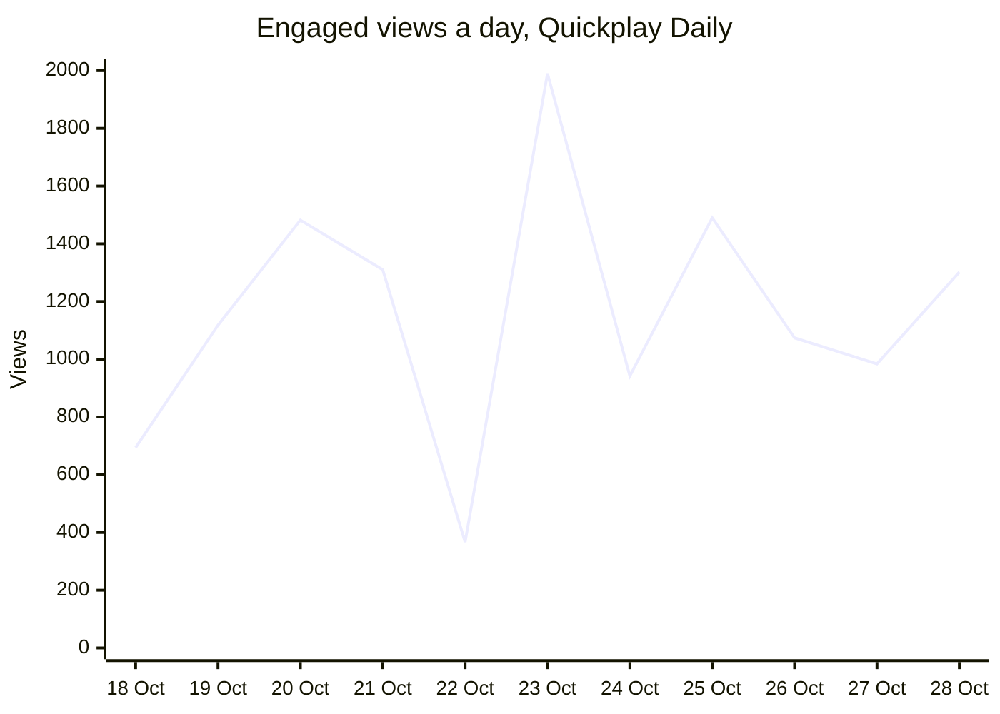

# Quickplay hub

Updated Saturday 31 October, 13:09 UK.

**31 subscribers, 16,406 engaged Shorts views in 90 days (0.55% of the 3M expanded tier), 4 to do, 0 keys need fixing.**

## Your actions

- [ ] **Check the Quickplay Facebook Page for a restriction** (overdue, was due Tue 27 Oct): [issue #34](https://github.com/quickplay-studio/quickplay-autopilot/issues/34)
- [ ] **Find out why TikTok restricted the account on 19 October** (overdue, was due Wed 28 Oct): [issue #35](https://github.com/quickplay-studio/quickplay-autopilot/issues/35)
- [ ] **Recommended, free: a Mistral key (the biggest free writing allowance; phone check, no...** (overdue, was due Fri 30 Oct): [open](https://console.mistral.ai/)
- [ ] **Take the pipeline's Claude calls off your chat allowance: claim the Max API credits...** (due Sat 31 Oct): [open](https://claude.ai/settings/billing)

Coming up and optional (7)

- [ ] **Clipping is paused: keep it paused or restart it (review Sunday 8 November)** (due Sun 8 Nov): [issue #49](https://github.com/quickplay-studio/quickplay-autopilot/issues/49)
- [ ] **Renew the Instagram seed key (IG_TOKEN) before it runs out** (due Thu 10 Dec): [issue #36](https://github.com/quickplay-studio/quickplay-autopilot/issues/36)
- [ ] **Recommended, free: a Cloudflare Workers AI key (about 25 more scripts a day; no card)** (optional): [open](https://dash.cloudflare.com/sign-up)
- [ ] **Optional: let the hub's page rebuild only when the page itself changes (one setting)** (optional): [open](https://github.com/quickplay-studio/quickplay-autopilot/settings/pages)
- [ ] **Optional, free: a SambaNova key (a small extra writing allowance; no card)** (optional): [open](https://cloud.sambanova.ai/)
- [ ] **Create the Quickplay Music channel in YouTube Studio and connect it** (optional): [issue #42](https://github.com/quickplay-studio/quickplay-autopilot/issues/42)
- [ ] **Create the Quickplay Diario channel in YouTube Studio and connect it** (optional): [issue #43](https://github.com/quickplay-studio/quickplay-autopilot/issues/43)

## YPP progress

| Tier | Subscribers | Shorts views, 90 days | Views a day needed |
|---|---|---|---|
| Expanded, open now | 31 of 500 (6.20%) | 16,406 of 3,000,000 (0.55%) | 33,152 |
| Full, from 1 February 2027 | 31 of 1,000 (3.10%) | 16,406 of 10,000,000 (0.16%) | 110,929 |

| Engaged views, last 7 reported days | Views, last 24 hours | Uploads, last 24 hours | Days to 1 Feb 2027 |
|---|---|---|---|
| 8,149 (to Wed 28 Oct) | 8,202 | 22 | 93 |

The full tier also accepts 20M Shorts views in 90 days. YouTube reports engaged views about 3 days late.

## Is it getting better

Engaged views a day, 7-day average: **1,164**, up from 904 a week earlier.
Engaged share (Shorts that hold viewers past the opening, 7-day median): **30%**, was 29% a week earlier.
Loop vs frozen control: too few to tell (0): 0 control Shorts public 24 hours or more, 8 needed over 3 days or more that also have the loop's Shorts (0 so far).
Sameness, how alike the channel's Shorts are (0 to 1, lower is better): **0.06** over 14 days to Sat 31 Oct, alert at 0.2; the commonest recipe is 4% of them (limit 35%).

Days YouTube has reported, to Wed 28 Oct. More: [analytics/insights.md](analytics/insights.md).

## Tests and changes

**18 contests live, 15 with a lean or a verdict.** Evolve has 0 champions, 0 adopted genes and has tried 4 genes ([summary](analytics/evolve.md)).

| Contest | Arms (Shorts so far) | Verdict | Days left |
|---|---|---|---|
| title emoji | emoji 42, none 47 | running, leaning emoji | 7 |
| comment replies | on 48, off 44 | running, leaning off | 7 |
| length | 25 to 34 s 40, 35 to 44 s 46 | running, leaning 25 to 34 s | 8 |
| ending | loop 37, question 32 | running, leaning loop | 10 |
| posting quarter (UK) | 06:00 to 12:00 32, 12:00 to 18:00 35 | running, leaning 06:00 to 12:00 | 10 |
| title answer (stated or held back) | stated 33, held back 36 | running, leaning stated | 10 |
| camera energy | steady 33, lab 27 | running, leaning lab | 11 |
| angles shown to the writer | shown 24, hidden 26 | running, leaning hidden | 12 |

**Change ledger:** 280 changes, 91 live; verdicts so far: 56 worse, 55 no change, 40 better, 37 too early, 37 overlapped.

| Change | Date | What | Target | Verdict |
|---|---|---|---|---|
| CH-280 | Sat 24 Oct | Recipe: Back to normal for writer model "groq:openai/gpt-oss-120b" | yt_rel | no change |
| CH-279 | Sat 24 Oct | Recipe: Lean towards day posted "Friday" | yt_rel | no change |
| CH-278 | Sat 24 Oct | Recipe: Lean towards colour grade "natural" | yt_rel | better |
| CH-277 | Sat 24 Oct | Recipe: Lean towards captions "lab-captions-1019" | yt_rel | no change |
| CH-276 | Sat 24 Oct | Recipe: Lean towards length "25 to 34 s" | yt_rel | better |
| CH-275 | Sat 24 Oct | Recipe: Lean towards kind of short "news" | yt_rel | worse |
| CH-274 | Sat 24 Oct | Recipe: Lean towards kind of short "breaking" | yt_rel | too early |
| CH-273 | Sat 24 Oct | Recipe: Use less hook style "number" | yt_rel | better |

Waiting for a verdict (check day): CH-264 (Fri 6 Nov), CH-159 (Wed 4 Nov), CH-158 (Wed 4 Nov), CH-157 (Wed 4 Nov), CH-156 (Wed 4 Nov), CH-155 (Wed 4 Nov). All of them: [analytics/changes.csv](analytics/changes.csv).

## Keys

**Nothing needs fixing.** 15 ok, 0 ending soon, 0 failing, 18 not set up; checked Sat 31 Oct, 13:09 UK.

| Key | State | Ends | Fix |
|---|---|---|---|
| Instagram key in use (Quickplay Daily) | ok | Wed 30 Dec 2026 |  |
| Facebook Page key: Quickplay Daily (FB_PAGE_TOKEN) | ok | Sun 17 Jan 2027 |  |
| TikTok sign-in (refresh token) | ok | Sun 17 Oct 2027 |  |
| Content Rewards login (saved cookies) | ok | Sat 21 Nov 2026 |  |
| Vyro login (saved cookies) | ok | Fri 22 Oct 2027 |  |
| FreeLLMAPI router: 26 models on kilo, ovh; search: none | live | none | |

Also ok (9): youtube, youtube_clips, youtube_gaming, youtube_irl, IG_TOKEN, GEMINI_API_KEY, GROQ_API_KEY, OPENROUTER_API_KEY, CLAUDE_CODE_OAUTH_TOKEN.

Optional keys not set up (18)

- **Instagram:** IG_CLIPS_TOKEN, IG_GAMING_TOKEN, IG_IRL_TOKEN
- **Facebook:** FB_CLIPS_PAGE_TOKEN, FB_GAMING_PAGE_TOKEN, FB_IRL_PAGE_TOKEN
- **AI models:** CEREBRAS_API_KEY ([sign up](https://cloud.cerebras.ai/)), CF_API_TOKEN ([sign up](https://dash.cloudflare.com/profile/api-tokens)), MISTRAL_API_KEY ([sign up](https://console.mistral.ai/api-keys)), SAMBANOVA_API_KEY ([sign up](https://cloud.sambanova.ai/apis)), APIFY_TOKEN ([sign up](https://console.apify.com/settings/integrations)), ANTHROPIC_API_KEY ([sign up](https://platform.claude.com/settings/keys)), TAVILY_API_KEY ([sign up](https://app.tavily.com/home)), EXA_API_KEY ([sign up](https://dashboard.exa.ai/api-keys)), FIRECRAWL_API_KEY ([sign up](https://www.firecrawl.dev/app/api-keys)), LINKUP_API_KEY ([sign up](https://app.linkup.so/api-keys)), OLLAMA_API_KEY ([sign up](https://ollama.com/settings/keys)), LLM7_API_KEY ([sign up](https://llm7.io))

Add any of them as an Actions secret: [new secret](https://github.com/quickplay-studio/quickplay-autopilot/settings/secrets/actions/new).

## Channels

- **Quickplay Daily**: 10 of 15 posted today, sign-in ok
- **Quickplay Music**: 0 of 6 posted today, no sign-in yet
- **Quickplay Gaming Clips**: 0 of 6 posted today, sign-in ok
- **Quickplay IRL Clips**: 0 of 6 posted today, sign-in ok
- **Quickplay Clips**: 0 of 6 posted today, sign-in ok
- **Quickplay Diario**: 0 of 6 posted today, sign-in ok
- Clipping paused since Mon 26 Oct: the clip channels post original Shorts.

---
[How it works](docs/HOW_IT_WORKS.md) · [Actions](https://github.com/quickplay-studio/quickplay-autopilot/actions) · [Issues](https://github.com/quickplay-studio/quickplay-autopilot/issues) · [Insights](analytics/insights.md) · [Weekly review](analytics/weekly.md) · [Sameness](analytics/sameness.md) · [Joint](analytics/joint.md)
