# Quickplay Daily review

**Progress** (Sat 31 Oct, 16:41): 31 of 1,000 subscribers · 17,547 of 10 million Shorts views in 90 days · 8,118 views in the last 24 hours (about 110,916 a day needed, 93 days left) · Instagram 2 and Facebook 0 followers.

YouTube checked Sat 31 Oct 16:26 (UK): 15 scheduled, 135 public, 30 uploads in the last 24 hours.

Instagram: connected as quickplaydaily · Facebook: connected to Quickplay Daily (checked Sat 31 Oct 11:35).

## Posts by day

YouTube counts Shorts by the day they go public. Instagram and Facebook build up to the same number over time.

| Day | YouTube | Instagram | Facebook | Target met? |
|---|---|---|---|---|
| Sun 1 Nov | 0 public, 5 scheduled | 0 | 0 | ⏳ 5 of 14 scheduled |
| Sat 31 Oct | 17 public, 14 scheduled | 8 | 1 | ✅ done |
| Fri 30 Oct | 10 public | 8 | 1 | ⚠️ 10 of 15 |
| Thu 29 Oct | 7 public | 0 | 0 | no target then |
| Wed 28 Oct | 28 public | 0 | 1 | ✅ all out |
| Tue 27 Oct | 27 public | 8 | 1 | ✅ all out |
| Mon 26 Oct | 12 public | 8 | 1 | ⚠️ 12 of 15 |
| Sun 25 Oct | 18 public | 4 | 1 | ✅ all out |

## Voice test

Each narrator is tried on real Shorts and judged on viewers not swiping away (1.00 x = typical for Shorts posted around the same time). GitHub gives the winners more Shorts by itself.

- lily (British female, bright): 1.00 x typical, 26% stayed past the first seconds, 6 Shorts
- lewis (British male, deeper and calm): 0.96 x typical, 23% stayed past the first seconds, 5 Shorts
- george_quick (British male, clear and quicker): 0.82 x typical, 27% stayed past the first seconds, 5 Shorts
- isabella (British female, warm): 1.42 x typical, 34% stayed past the first seconds, 2 Shorts
- heart (American female, expressive): 0.80 x typical, 26% stayed past the first seconds, 2 Shorts
- george_turbo (British male, the george voice on Chatterbox-Turbo (350M, one-step decoder, no exaggeration or cfg), same pace): 0 Shorts measured so far
- lab-voice-1028 (British male, 3.15 words a second): 0 Shorts measured so far

## Look lab

New versions of the captions, voice pace, camera, colour and opening are tried on real Shorts. A version that beats the one it came from stays, and the next change builds on it.

- Testing captions: 68px weight 600 at 1290px, 3 words at a time, spoken word #FFFFFF, no panel (3 of 8 Shorts measured)
- Testing voice: British male, 3.15 words a second (0 of 8 Shorts measured)
- Testing energy: camera motion 0.7, punch-ins 0.03 (1 of 8 Shorts measured)
- Testing grade: contrast(1.0) saturate(1.0) sepia(0.05) brightness(1.0), vignette 0.0 (0 of 8 Shorts measured)
- Testing opening: the picture alone for 3 words, then the hook's card (0 of 8 Shorts measured)
- 2026-10-31: grade retired lab-grade-1027 (0.79x against 1.18x for natural over 13 Shorts)
- 2026-10-31: voice retired daniel (1.00x against 1.40x for isabella over 15 Shorts)
- 2026-10-30: opening retired lab-opening-1026 (1.10x against 1.13x for image_first over 10 Shorts)
- 2026-10-30: energy retired lab-energy-1025 (0.99x against 1.17x for steady over 8 Shorts)
- 2026-10-30: voice retired michael (1.19x against 1.57x for daniel over 11 Shorts)
- 2026-10-28: voice retired george_dramatic (making room for a new test (1.03x over 9 Shorts))

## Needs a look

Nothing here needs approving (approval is off): a failed Short is skipped and the next one takes its slot. Only Instagram or Facebook errors that keep coming back need fixing, in a Claude chat with the quickplay skill.

- **QD-086** What is the fastest land animal in the world? 🐆: failed. RuntimeError: checks failed: unclear narration in beats [2, 5]
- **QD-126** JADE hits US charts years after debut 🎶: failed. RuntimeError: checks failed: unclear narration in beats [0]
- **QD-217** Star Stories #1: Richard Hammond house tour: bats pause £2m 🦇: failed. RuntimeError: checks failed: unclear narration in beats [0]
- **QD-281** : failed (board rejected). meta.title: 1 to 70 characters
- **QD-286** : failed (board rejected). look.grade: one of ['cinematic', 'natural']
- **QD-129** Clayface: The dark new body horror film in cinemas 🎬: facebook 2026-10-23 09:37 facebook publish: 400 {'error': {'message': 'We limit how often you can post, comment or do other things in a given amount of time in order to help protect the community from spam. You can try again later. Learn More', 'type': 'OAuthException', 'code': 368, 'err
- **QD-189** Kylian Mbappé: the 87th minute moment that changed everything ⚽: instagram 2026-10-28 15:52 instagram processing: {'status_code': 'ERROR', 'status': 'ERROR', 'id': '17936872164167410'}
- **QD-207** Game Facts #4: halloween 2026 game: the price drop you missed: instagram 2026-10-28 09:48 instagram processing: {'status_code': 'ERROR', 'status': 'ERROR', 'id': '17936768628167410'}
- **QD-209** GTA 6 launch makes Emberville delay to 2027 🎮: instagram 2026-10-28 20:42 instagram processing: {'status_code': 'ERROR', 'status': 'ERROR', 'id': '17936944932167410'}
- **QD-228** Star Stories #2: Matthew Perry Netflix documentary 📺: instagram 2026-10-28 09:49 instagram processing: {'status_code': 'ERROR', 'status': 'ERROR', 'id': '17936768706167410'}

## Waiting for your approval

Reply to the daily message ("approve all", "approve all except QD-032", "reject QD-032"), or on GitHub: Actions, publish, Run workflow, and type the same.

### QD-144 · Tate McRae hits #1 in Australia 🎶
awaiting approval · 25 s · [watch preview](https://github.com/quickplay-studio/quickplay-autopilot/releases/tag/untagged-135ae7dbeab2e30bcf25)
- dry run: always waits for approval, never uploaded

### QD-233 · Beyonce's 2003 album sold 317k in week one 🎤
awaiting approval · 31 s · [watch preview](https://github.com/quickplay-studio/quickplay-autopilot/releases/tag/untagged-39e898c890f9b5e0d19b)
- dry run: always waits for approval, never uploaded

### QD-235 · Screen Time #5: Godzilla Minus One: the Oscar detail you missed
awaiting approval · 29 s · [watch preview](https://github.com/quickplay-studio/quickplay-autopilot/releases/tag/untagged-170659f512152c5cec1c)
- dry run: always waits for approval, never uploaded

### QD-236 · Big Science #2: James Webb Space Telescope 🔭
awaiting approval · 37 s · [watch preview](https://github.com/quickplay-studio/quickplay-autopilot/releases/tag/untagged-781c10b33a6b853aae08)
- dry run: always waits for approval, never uploaded

### QD-237 · Science Explained #3: How does gravity work? 🌌
awaiting approval · 37 s · [watch preview](https://github.com/quickplay-studio/quickplay-autopilot/releases/tag/untagged-70c9eb3dc6b5ca390831)
- dry run: always waits for approval, never uploaded

### QD-238 · Harry Kane's Ballon d'Or: the historic detail
awaiting approval · 37 s · [watch preview](https://github.com/quickplay-studio/quickplay-autopilot/releases/tag/untagged-be1abdd6a83fed70977e)
- dry run: always waits for approval, never uploaded

### QD-239 · Level Up #3: Minecraft: Why the logo and textures changed
awaiting approval · 36 s · [watch preview](https://github.com/quickplay-studio/quickplay-autopilot/releases/tag/untagged-9744bd94a18c7de4f045)
- dry run: always waits for approval, never uploaded

### QD-242 · Player One #1: Tetris: the Moscow secret behind 520 million
awaiting approval · 30 s · [watch preview](https://github.com/quickplay-studio/quickplay-autopilot/releases/tag/untagged-51e279b6b60fa0641f33)
- dry run: always waits for approval, never uploaded

### QD-243 · On the Road #1: Bugatti Chiron: Why 10 Radiators?
awaiting approval · 40 s · [watch preview](https://github.com/quickplay-studio/quickplay-autopilot/releases/tag/untagged-ceeb119aa0a6231c1087)
- dry run: always waits for approval, never uploaded

### QD-244 · Time Machine #1: Apollo 13: the pencil detail they held back 🚀
awaiting approval · 29 s · [watch preview](https://github.com/quickplay-studio/quickplay-autopilot/releases/tag/untagged-0b1dde92a13db838c964)
- dry run: always waits for approval, never uploaded

### QD-270 · Star Stories #6: Walter Koenig Chekov casting: the look that won it
awaiting approval · 28 s · [watch preview](https://github.com/quickplay-studio/quickplay-autopilot/releases/tag/untagged-22efe870abb33e11a7bd)
- dry run: always waits for approval, never uploaded

### QD-271 · walter koenig: the career numbers you missed
awaiting approval · 28 s · [watch preview](https://github.com/quickplay-studio/quickplay-autopilot/releases/tag/untagged-ed799da8d03143ce15fc)
- dry run: always waits for approval, never uploaded

### TEST-L1024 · Free Steam games to grab before time runs out 🎮
awaiting approval · 27 s · [watch preview](https://github.com/quickplay-studio/quickplay-autopilot/releases/tag/untagged-963c381ac97f3f823bcc)
- dry run: always waits for approval, never uploaded

## In the queue

- **QD-320** Star Stories #10: Ian McKellen 🎭 (rendering next)
- **QD-321** Star Stories #12: Walter Koenig beat just one Chekov rival 🖖 (rendering next)

## On the channel (latest first)

### Sun 1 Nov 8:00 · Cars Explained #1: Carl Benz and the first modern motor car
scheduled · 32 s · music: circuit-rush · [script](../boards/done/QD-314.json) · [YouTube](https://youtube.com/shorts/bApCHvAsVU0)

### Sun 1 Nov 7:00 · Animals Explained #2: Golden Retrievers: The story of one puppy 🐾
scheduled · 27 s · music: good-energy · [script](../boards/done/QD-313.json) · [YouTube](https://youtube.com/shorts/8JeQF-_ZOHo)

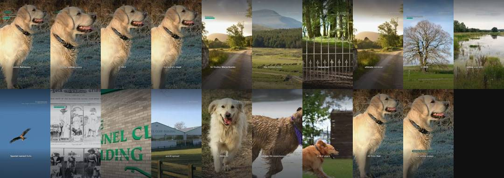

### Sun 1 Nov 6:00 · Sport Shocks #6: Harry Kane: the 25 year wait ends
scheduled · 29 s · music: level · [script](../boards/done/QD-310.json) · [YouTube](https://youtube.com/shorts/T53l15Ir52Y)

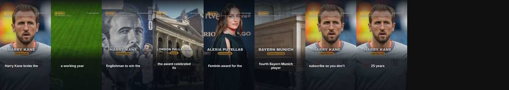

### Sun 1 Nov 1:30 · Sport Shocks #8: William Contreras: $10k to MVP 🧤
scheduled · 27 s · music: in-battery · [script](../boards/done/QD-312.json) · [YouTube](https://youtube.com/shorts/zwbUPvWUIH8)

### Sun 1 Nov 0:30 · Final Fantasy Resonance: why critics love it
scheduled · 32 s · music: in-battery · [script](../boards/done/QD-311.json) · [YouTube](https://youtube.com/shorts/4z9j0wvHIMA)

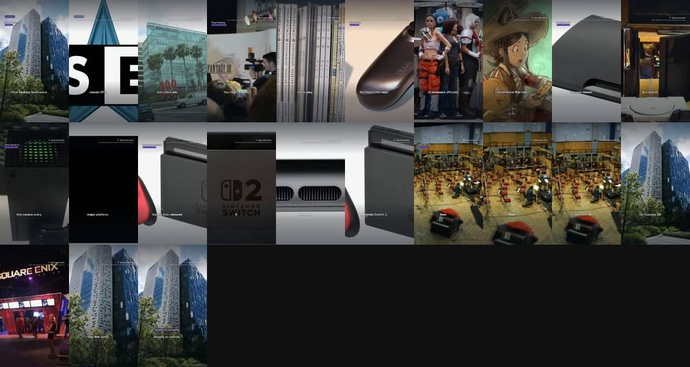

### Sat 31 Oct 23:20 · Patrick Stewart: his final film role revealed 🎬
scheduled · 44 s · music: in-battery · [script](../boards/done/QD-309.json) · [YouTube](https://youtube.com/shorts/lZAM8FBuEKo)

### Sat 31 Oct 22:15 · Star Stories #12: Ian McKellen: the history you missed 🎭
scheduled · 42 s · music: in-battery · [script](../boards/done/QD-308.json) · [YouTube](https://youtube.com/shorts/fbhBe--2Ibg)

### Sat 31 Oct 21:40 · Star Stories #10: Ian McKellen leads tributes to Sir Patrick Stewart
scheduled · 30 s · music: city-of-the-wolf · [script](../boards/done/QD-307.json) · [YouTube](https://youtube.com/shorts/wArb7v2UJcI)

### Sat 31 Oct 21:05 · Patrick Stewart best moments: icon dies at 86 🎭
scheduled · 30 s · music: fire-in-the-sky · [script](../boards/done/QD-304.json) · [YouTube](https://youtube.com/shorts/2Rc_v63SxZI)

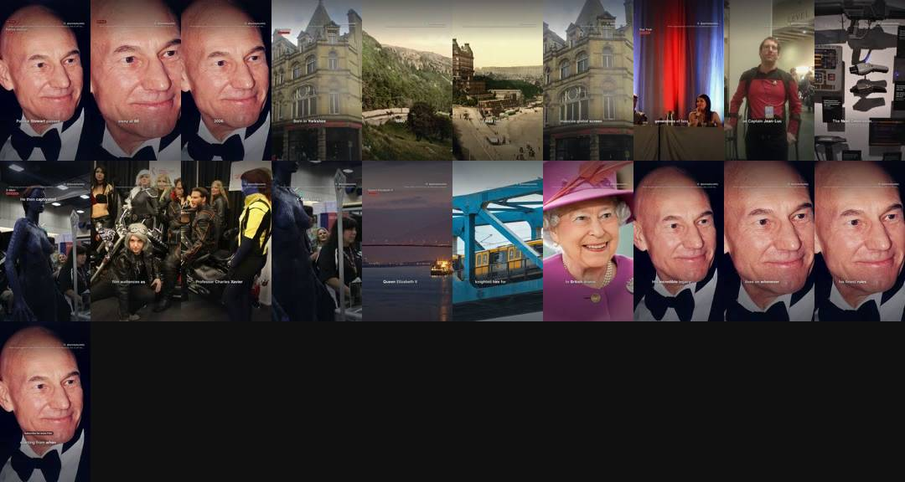

### Sat 31 Oct 20:00 · Patrick Stewart: the detail you missed
scheduled · 22 s · music: fire-in-the-sky · [script](../boards/done/QD-303.json) · [YouTube](https://youtube.com/shorts/kIccY1HgYDU)

### Sat 31 Oct 19:25 · Star Stories #8: Ian McKellen joins Marvel in Avengers Doomsday
scheduled · 32 s · music: in-battery · [script](../boards/done/QD-306.json) · [YouTube](https://youtube.com/shorts/haDiT1o6Tw0)

### Sat 31 Oct 18:50 · Patrick Stewart: the legacy he leaves behind
scheduled · 27 s · music: impossible-sacrifice · [script](../boards/done/QD-302.json) · [YouTube](https://youtube.com/shorts/AaQYePHIyoE)

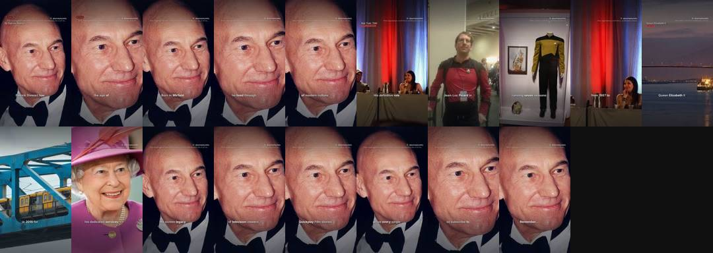

### Sat 31 Oct 17:45 · Film Facts #5: Patrick Stewart: a lifetime of theatre 🎭
scheduled · 38 s · music: impossible-sacrifice · [script](../boards/done/QD-301.json) · [YouTube](https://youtube.com/shorts/lpRMQY97GiY)

### Sat 31 Oct 17:10 · Star Stories #6: Patrick Stewart was knighted for drama in 2010 👑
scheduled · 28 s · music: level · [script](../boards/done/QD-305.json) · [YouTube](https://youtube.com/shorts/wWsYuR07DXk)

### Sat 31 Oct 16:35 · Patrick Stewart: the number behind his legacy 🎬
private · 38 s · music: scale-the-mountain · [script](../boards/done/QD-300.json) · [YouTube](https://youtube.com/shorts/_isY2ryqXHA)

### Sat 31 Oct 15:30 · Film Facts #3: Patrick Stewart died on 28 October 2026
public · 1 views · 31 s · music: impossible-sacrifice · [script](../boards/done/QD-299.json) · [YouTube](https://youtube.com/shorts/SzesUffWQxM)

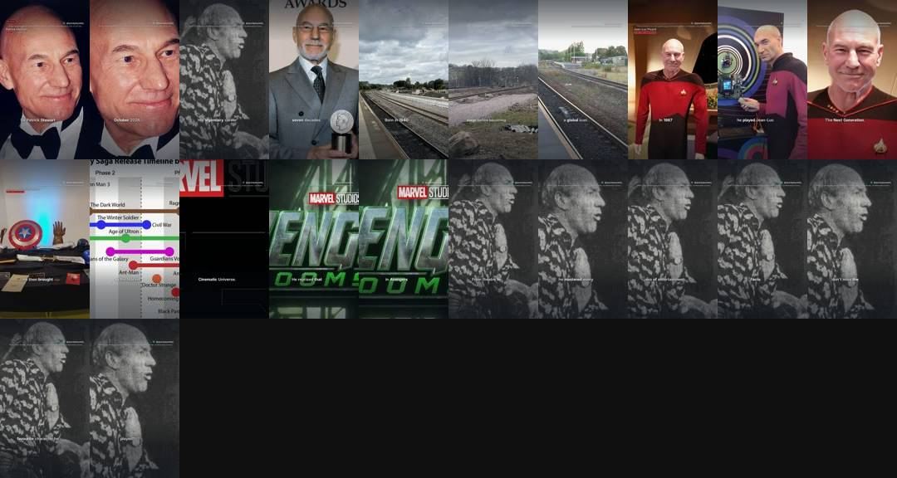

### Sat 31 Oct 14:30 · Patrick Stewart: Final Role Releases 18 December
public · 2 views · 40 s · music: impossible-sacrifice · [script](../boards/done/QD-298.json) · [YouTube](https://youtube.com/shorts/NgG2Zi22cEg)

### Sat 31 Oct 14:00 · GTA 6: dog poop weapon 🚮
public · 5 views · 27 s · music: across-seas-and-lands · [script](../boards/done/QD-296.json) · [YouTube](https://youtube.com/shorts/3CoOwKWcjmw)

### Sat 31 Oct 13:30 · Game Explained #2: Why Does Pokémon Have Two Versions? 🎮
public · 1 views · 27 s · music: death-duel · [script](../boards/done/QD-297.json) · [YouTube](https://youtube.com/shorts/X4-havfO9Ow)

### Sat 31 Oct 13:00 · Harry Kane Ballon d'Or: the detail behind the win
public · 28 s · music: across-seas-and-lands · [script](../boards/done/QD-295.json) · [YouTube](https://youtube.com/shorts/jwRA2EI0M0w)

### Sat 31 Oct 12:00 · GTA 6's morality scale tops out at Irredeemable
public · 16 views · 29 s · music: risen · [script](../boards/done/QD-291.json) · [YouTube](https://youtube.com/shorts/-693GWV2F9w)

### Sat 31 Oct 9:00 · Culture Explained #1: Doctor Who: why the Doctor regenerates
public · 56 views · 36 s · music: risen · [script](../boards/done/QD-290.json) · [YouTube](https://youtube.com/shorts/npZfLkjWHbM)

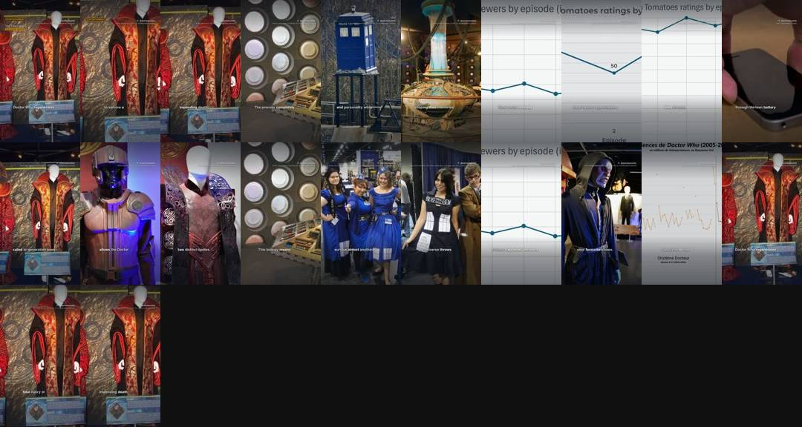

### Sat 31 Oct 8:00 · Sport Shocks #5: Super Bowl XLVII: the day the lights went out 💡
public · 74 views · 42 s · music: duty-calls · on Instagram · [script](../boards/done/QD-288.json) · [YouTube](https://youtube.com/shorts/PVcJnH7wnLw)

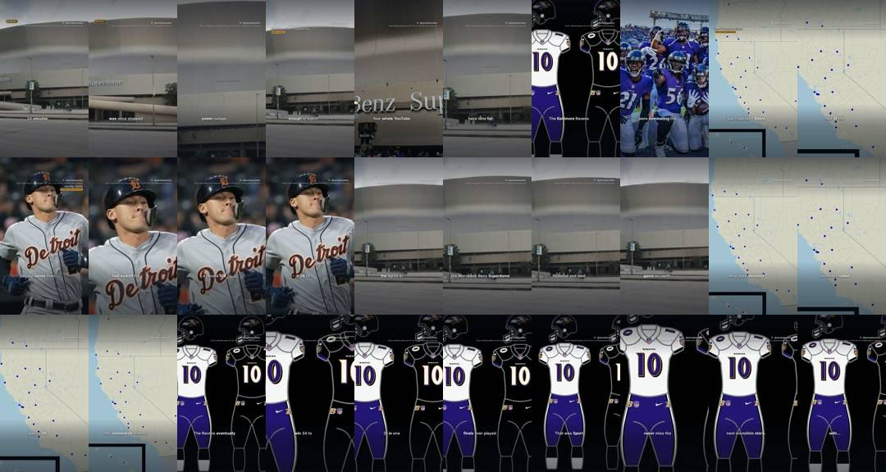

### Sat 31 Oct 7:00 · Messi vs Ronaldo: the record one of them missed
public · 362 views · 30 s · music: duty-calls · on Instagram · [script](../boards/done/QD-287.json) · [YouTube](https://youtube.com/shorts/HSKp46wJ6TY)

### Sat 31 Oct 6:00 · Song Secrets #4: Michael Jackson's Thriller tops charts 37 weeks 🎵
public · 463 views · 36 s · music: dance-with-you · [script](../boards/done/QD-280.json) · [YouTube](https://youtube.com/shorts/el4EkoNqHOk)

### Sat 31 Oct 5:00 · Food Facts #1: Bonfire Night: the treat you must try 🍎
public · 13 views · 18 s · music: treasure-hunt · [script](../boards/done/QD-293.json) · [YouTube](https://youtube.com/shorts/Gv2YB6R4NoQ)

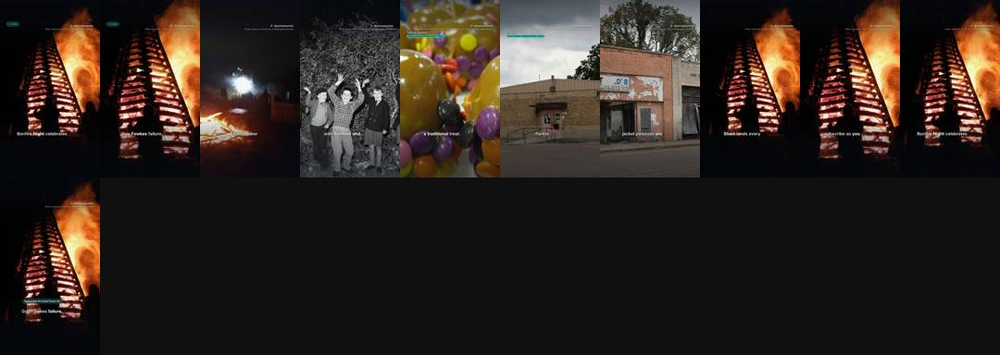

### Sat 31 Oct 4:00 · Emily McGonagle: the secret career change 🎙️
public · 91 views · 33 s · music: rubberband · [script](../boards/done/QD-285.json) · [YouTube](https://youtube.com/shorts/YXfaK7pdxJg)

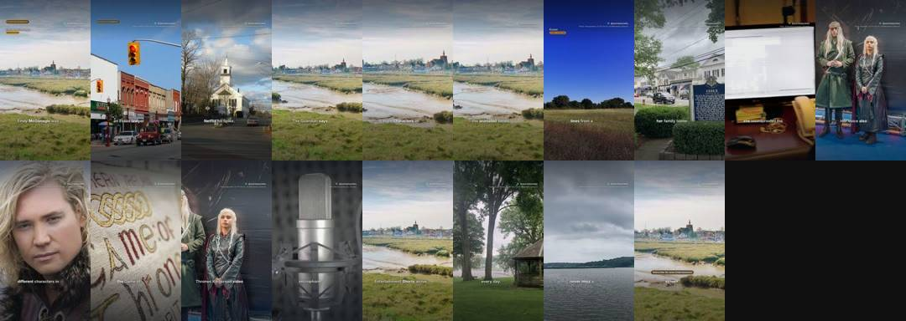

### Sat 31 Oct 3:00 · Walter Koenig: the hidden audition fact 🌟
public · 501 views · 28 s · music: defying-gravity · [script](../boards/done/QD-284.json) · [YouTube](https://youtube.com/shorts/Tl5ullZxXYQ)

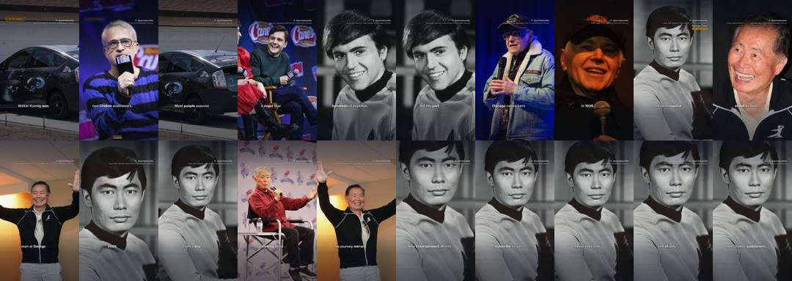

### Sat 31 Oct 1:30 · Claudia Winkleman leads Celebrity Traitors series two
public · 164 views · 38 s · music: twin-lynches · [script](../boards/done/QD-283.json) · [YouTube](https://youtube.com/shorts/cJIA6wBfhMg)

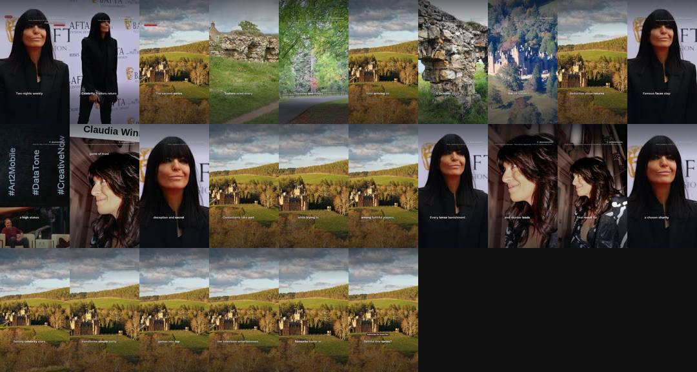

### Sat 31 Oct 0:30 · William Contreras: 7th catcher World Series MVP 🏆
public · 1,100 views · 29 s · music: once-upon-a-time · on Instagram · on Facebook · [script](../boards/done/QD-282.json) · [YouTube](https://youtube.com/shorts/YnvZjFVmJuE)

### Fri 30 Oct 15:30 · England vs PNG: the 68-point twist
public · 166 views · 37 s · music: once-upon-a-time · on Instagram · [script](../boards/done/QD-279.json) · [YouTube](https://youtube.com/shorts/TkoKydpcis4)

### Fri 30 Oct 14:00 · Ballon d'Or #4: Harry Kane Ballon d'Or: the 73 goal detail
public · 405 views · 40 s · music: once-upon-a-time · on Instagram · [script](../boards/done/QD-278.json) · [YouTube](https://youtube.com/shorts/3u12UL9te3w)

### Fri 30 Oct 13:00 · Celebrity Traitors #2: Final: series two ends today 🏁
public · 385 views · 26 s · music: stake-out · [script](../boards/done/QD-277.json) · [YouTube](https://youtube.com/shorts/qSpSNwWEBDQ)

### Fri 30 Oct 12:00 · Game Explained #1: Switch cartridge taste: the real reason 👅
public · 140 views · 37 s · music: hopping-trains · on Instagram · [script](../boards/done/QD-276.json) · [YouTube](https://youtube.com/shorts/CoVkFUukloo)

### Fri 30 Oct 11:00 · Harry Kane wins the Ballon d'Or after 25 years
public · 714 views · 37 s · music: in-battery · [script](../boards/done/QD-275.json) · [YouTube](https://youtube.com/shorts/vKutbd0tO_s)

### Fri 30 Oct 9:30 · Dune: Part Three #2: Timothée Chalamet: Dune 3 trailer arrives
public · 65 views · 39 s · music: in-battery · on Instagram · [script](../boards/done/QD-274.json) · [YouTube](https://youtube.com/shorts/ybpJ2NLXQXg)

### Fri 30 Oct 8:00 · Sport Shocks #4: Ballon d'Or 2026 rankings: Harry Kane's first win 🏆
public · 856 views · 27 s · music: fire-in-the-sky · on Instagram · [script](../boards/done/QD-273.json) · [YouTube](https://youtube.com/shorts/EYdrZlrjsDk)

### Fri 30 Oct 6:30 · Sport Shocks #2: ballon d'or 2026 reaction: the detail you missed
public · 644 views · 36 s · music: fire-in-the-sky · [script](../boards/done/QD-246.json) · [YouTube](https://youtube.com/shorts/rsTvuhXP5xw)

### Fri 30 Oct 3:30 · Harry Kane Ballon d'Or: first win in London 🏆
public · 887 views · 25 s · music: fire-in-the-sky · [script](../boards/done/QD-272.json) · [YouTube](https://youtube.com/shorts/U_eHPDhew8M)

### Thu 29 Oct 18:30 · Sport Explained #1: Ballon d'Or records: Messi vs Ronaldo
public · 1,174 views · 28 s · music: across-seas-and-lands · on Instagram · on Facebook · [script](../boards/done/QD-266.json) · [YouTube](https://youtube.com/shorts/sCd5ulaxtyM)

