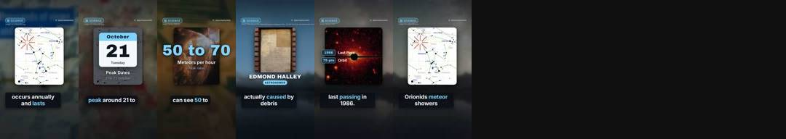
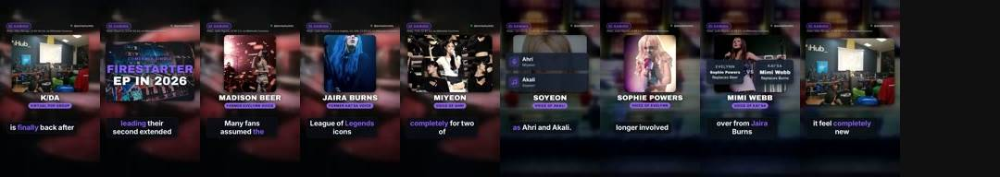

# Quickplay Daily review

**Progress** (Wed 21 Oct, 20:40): 7 of 1,000 subscribers · 4,937 of 10 million Shorts views in 90 days · 6,263 views in the last 24 hours (about 111,056 a day needed, 103 days left) · Instagram 0 and Facebook 0 followers.

YouTube checked Wed 21 Oct 20:08 (UK): 9 scheduled, 76 public, 38 uploads in the last 24 hours.

Instagram: connected as quickplaydaily · Facebook: connected to Quickplay Daily (checked Wed 21 Oct 15:13).

## Posts by day

YouTube counts Shorts by the day they go public. Instagram and Facebook build up to the same number over time.

| Day | YouTube | Instagram | Facebook | Target met? |
|---|---|---|---|---|
| Thu 22 Oct | 0 public, 6 scheduled | 0 | 0 | ⏳ 6 of 40 scheduled |
| Wed 21 Oct | 26 public, 3 scheduled | 14 | 12 | ⏳ 26 of 40 so far, 3 more scheduled |
| Tue 20 Oct | 7 public | 10 | 10 | ⚠️ 7 of 24 |
| Mon 19 Oct | 19 public | 6 | 6 | ⚠️ 19 of 24 |
| Sun 18 Oct | 8 public | 0 | 0 | no target then |
| Sat 17 Oct | 0 public | 0 | 0 | no target then |
| Fri 16 Oct | 0 public | 0 | 0 | no target then |
| Thu 15 Oct | 0 public | 0 | 0 | no target then |

## Voice test

Each narrator is tried on real Shorts and judged on viewers not swiping away (1.00 x = typical for Shorts posted around the same time). GitHub gives the winners more Shorts by itself.

- george_dramatic (British male, more dramatic delivery): 1.12 x typical, 22% stayed past the first seconds, 3 Shorts
- george (British male, clear): 1.00 x typical, 32% stayed past the first seconds, 10 Shorts
- emma (British female): 1.83 x typical, 56% stayed past the first seconds, 2 Shorts
- george_quick (British male, clear and quicker): 0.92 x typical, 27% stayed past the first seconds, 1 Short
- lewis (British male, deeper and calm): 0 Shorts measured so far
- daniel (British male, brisk): 0 Shorts measured so far
- isabella (British female, warm): 0 Shorts measured so far
- lily (British female, bright): 0 Shorts measured so far
- michael (American male, friendly): 0 Shorts measured so far
- heart (American female, expressive): 0 Shorts measured so far
- lab-voice-1019 (British male, 3.15 words a second): 0 Shorts measured so far

## Look lab

New versions of the captions, voice pace, camera, colour and opening are tried on real Shorts. A version that beats the one it came from stays, and the next change builds on it.

- Testing captions: 68px weight 600 at 1290px, 4 words at a time, spoken word #FFFFFF, no panel (1 of 8 Shorts measured)
- Testing voice: British male, 3.15 words a second (0 of 8 Shorts measured)
- Testing energy: camera motion 0.7, punch-ins 0.05 (0 of 8 Shorts measured)
- Testing grade: contrast(1.0) saturate(0.94) sepia(0.0) brightness(1.0), vignette 0.0 (1 of 8 Shorts measured)
- Testing opening: the picture alone for 1 word, then the hook's card (0 of 8 Shorts measured)

## Needs a look

Nothing here needs approving (approval is off): a failed Short is skipped and the next one takes its slot. Only Instagram or Facebook errors that keep coming back need fixing, in a Claude chat with the quickplay skill.

- **QD-056** Street Fighter movie: Chun-Li's 12-egg diet 🥚: failed. RuntimeError: checks failed: unclear narration in beats [3]
- **QD-076** How Barbara Palvin was discovered at age 13 ✨: failed. RuntimeError: checks failed: unclear narration in beats [4]
- **QD-086** What is the fastest land animal in the world? 🐆: failed. RuntimeError: checks failed: unclear narration in beats [2, 5]
- [raphinha birth date in Porto Alegre ⚽](https://youtube.com/shorts/ApvkxPKexGc): private and not scheduled

## In the queue

- **QD-099** Above the Below release date revealed 🎬 (rendering next)
- **QD-100** Best Buy launches Pokemon TCG sale 📱 (rendering next)
- **QD-101** Ella Langley and Morgan Wallen released new duet 🎶 (rendering next)
- **QD-102** Club Brugge 20 league titles history ⚽ (rendering next)
- **QD-103** Taylor Swift's haunted video twist 🎬 (rendering next)
- **QD-105** Alphonso Davies: From refugee to Bayern star 🏆 (rendering next)
- **QD-106** Scottish Premiership biggest stadium and history ⚽ (rendering next)
- **QD-107** How does ChatGPT process natural language queries? 🤖 (rendering next)

## On the channel (latest first)

### Thu 22 Oct 2:30 · Mark Allen snooker career highlights 🎱
scheduled · 30 s · music: twin-lynches · [script](../boards/done/QD-098.json) · [YouTube](https://youtube.com/shorts/29ehu4f0dRI)

### Thu 22 Oct 2:00 · The Beatles Please Please Me secret history revealed 🎸
scheduled · 21 s · music: death-duel · [script](../boards/done/QD-097.json) · [YouTube](https://youtube.com/shorts/oERciIImqJI)

### Thu 22 Oct 1:30 · Dave Raindance hits number one 🎶
scheduled · 27 s · music: good-energy · [script](../boards/done/QD-096.json) · [YouTube](https://youtube.com/shorts/CA8JNcmMZoc)

### Thu 22 Oct 1:00 · Which artist has won the most Grammy Awards? 🏆
scheduled · 20 s · music: dance-with-you · [script](../boards/done/QD-095.json) · [YouTube](https://youtube.com/shorts/Ulv7gqbpKuM)

### Thu 22 Oct 0:30 · What is the loudest sound ever recorded on Earth? 🌋
scheduled · 27 s · music: horizons · [script](../boards/done/QD-094.json) · [YouTube](https://youtube.com/shorts/L8Hzj6oXI1Y)

### Thu 22 Oct 0:00 · How Tetris became a global video game phenomenon 🧩
scheduled · 38 s · music: after-sunset · [script](../boards/done/QD-093.json) · [YouTube](https://youtube.com/shorts/_X6RQIMVXAw)

### Wed 21 Oct 23:30 · The day Godzilla was almost an octopus 🐙
scheduled · 29 s · music: after-sunset · [script](../boards/done/QD-092.json) · [YouTube](https://youtube.com/shorts/6_uQBelVyo0)

### Wed 21 Oct 23:00 · Japan's Phobos rover Idefix's two hour drill 🚀
scheduled · 36 s · music: horizons · [script](../boards/done/QD-091.json) · [YouTube](https://youtube.com/shorts/YTxtjZbLxdg)

### Wed 21 Oct 21:30 · Shrek 2 Remastered revealed with GTA parody 🧅
scheduled · 23 s · music: treasure-hunt · [script](../boards/done/QD-090.json) · [YouTube](https://youtube.com/shorts/_DiyJaLv6YY)

### Wed 21 Oct 18:00 · Bob Iger announces new book One Last Time 📖
public · 1 views · 22 s · music: level · on Facebook · [script](../boards/done/QD-089.json) · [YouTube](https://youtube.com/shorts/ipEPjlNKVxk)

### Wed 21 Oct 17:30 · Glee reboot officially confirmed 🎵
public · 5 views · 27 s · music: dance-with-you · on Facebook · [script](../boards/done/QD-088.json) · [YouTube](https://youtube.com/shorts/h9hs4IovByM)

### Wed 21 Oct 17:00 · Zelda Ocarina of Time different versions size 🗡️
public · 27 s · music: scale-the-mountain · on Facebook · [script](../boards/done/QD-087.json) · [YouTube](https://youtube.com/shorts/oA9hiDV3JXY)

### Wed 21 Oct 16:30 · The day Apollo 13 became a rescue mission 🚀
public · 26 s · music: across-seas-and-lands · on Facebook · [script](../boards/done/QD-085.json) · [YouTube](https://youtube.com/shorts/iQh-V6RdPMM)

### Wed 21 Oct 16:00 · Pac-Man: The pizza origin story 🍕
public · 1 views · 25 s · music: f16 · on Facebook · [script](../boards/done/QD-083.json) · [YouTube](https://youtube.com/shorts/5qb7XUBcYY8)

### Wed 21 Oct 15:30 · How Manchester United won the 1999 Champions League 🏆
public · 1 views · 24 s · music: across-seas-and-lands · on Facebook · [script](../boards/done/QD-082.json) · [YouTube](https://youtube.com/shorts/xU_YzAN_0x4)

### Wed 21 Oct 15:00 · Jupiter: Which is the largest planet? 🪐
public · 6 views · 28 s · music: defying-gravity · on Facebook · [script](../boards/done/QD-081.json) · [YouTube](https://youtube.com/shorts/1Qtndl8rCuY)

### Wed 21 Oct 14:30 · Who invented the World Wide Web? 🌐
public · 2 views · 28 s · music: circuit-rush · [script](../boards/done/QD-080.json) · [YouTube](https://youtube.com/shorts/n9u_lNVm3eA)

### Wed 21 Oct 14:00 · How often do the Orionids meteor showers occur? 🌠
public · 26 s · music: defying-gravity · on Facebook · [script](../boards/done/QD-079.json) · [YouTube](https://youtube.com/shorts/YzkUYea_37E)

### Wed 21 Oct 13:30 · Bohemian Rhapsody: the 5.55 minute record 🎸
public · 8 views · 34 s · music: walking-the-wire · [script](../boards/done/QD-078.json) · [YouTube](https://youtube.com/shorts/v4laO9KMtP4)

### Wed 21 Oct 13:00 · Anuel AA’s birth name and album timeline 🎤
public · 5 views · 28 s · music: rubberband · on Facebook · [script](../boards/done/QD-077.json) · [YouTube](https://youtube.com/shorts/AEzAI1mguKg)

### Wed 21 Oct 12:00 · ChatGPT adds new PIN lock for private chats 🔒
public · 4 views · 28 s · music: circuit-rush · on Facebook · [script](../boards/done/QD-075.json) · [YouTube](https://youtube.com/shorts/HPGQwI0SHBI)

### Wed 21 Oct 10:30 · K/DA returns with a brand new line-up 🎶
public · 6 views · 31 s · music: mirror-mirror · on Facebook · [script](../boards/done/QD-074.json) · [YouTube](https://youtube.com/shorts/P3r8h3msA7c)

### Wed 21 Oct 10:10 · Lamine Yamal ends Real Betis 15 game unbeaten run ⚽
public · 8 views · 26 s · music: gta-type-beat · on Facebook · [script](../boards/done/QD-062.json) · [YouTube](https://youtube.com/shorts/QnO9Y09ThbE)

### Wed 21 Oct 9:54 · Kylie Jenner makes Victoria's Secret show debut ✨
public · 1 views · 24 s · music: mirror-mirror · [script](../boards/done/QD-073.json) · [YouTube](https://youtube.com/shorts/80enLT-H0Zo)

### Wed 21 Oct 9:30 · Taylor Swift's Patient Zero hits three weeks at number one 🎵
public · 258 views · 19 s · music: f16 · [script](../boards/done/QD-061.json) · [YouTube](https://youtube.com/shorts/FQ27dGO66hk)

### Wed 21 Oct 8:50 · Larne face Linfield in Irish Premiership match ⚽
public · 76 views · 22 s · music: ego-chall · [script](../boards/done/QD-060.json) · [YouTube](https://youtube.com/shorts/b3dV8eVWOpE)

### Wed 21 Oct 8:10 · Japan launches historic mission to Mars's moon Phobos 🚀
public · 247 views · 26 s · music: pulsar · [script](../boards/done/QD-059.json) · [YouTube](https://youtube.com/shorts/jzxZdvaKr2E)

### Wed 21 Oct 7:30 · Zelda Ocarina of Time remake file size confirmed 🗡️
public · 433 views · 29 s · music: death-duel · [script](../boards/done/QD-058.json) · [YouTube](https://youtube.com/shorts/2PEgNuzSy0Y)

### Wed 21 Oct 4:30 · Who was the first person to win an EGOT? 🏆
public · 138 views · 32 s · music: impossible-sacrifice · on Instagram · [script](../boards/done/QD-072.json) · [YouTube](https://youtube.com/shorts/t3SSjxjQzqU)

### Wed 21 Oct 3:54 · How does GPS actually pinpoint your location? 🛰️
public · 19 views · 27 s · music: event-horizon · on Instagram · [script](../boards/done/QD-071.json) · [YouTube](https://youtube.com/shorts/PbSOlBJC74U)

### Wed 21 Oct 3:18 · Why do golf balls have dimples? ⛳
public · 91 views · 23 s · music: hopping-trains · on Instagram · [script](../boards/done/QD-070.json) · [YouTube](https://youtube.com/shorts/Y9sfjXFS4Z0)

### Wed 21 Oct 2:42 · The Beatles debut album recorded in 12 hours 🎸
public · 536 views · 33 s · music: death-duel · on Instagram · [script](../boards/done/QD-069.json) · [YouTube](https://youtube.com/shorts/FM2COeZ6Oi4)

### Wed 21 Oct 2:06 · The day Ready Player One began 🕹️
public · 61 views · 25 s · music: death-duel · on Instagram · [script](../boards/done/QD-068.json) · [YouTube](https://youtube.com/shorts/non50TmKEto)

### Wed 21 Oct 1:30 · Rod Stewart’s MTV launch record 🎤
public · 188 views · 39 s · music: death-duel · on Instagram · [script](../boards/done/QD-067.json) · [YouTube](https://youtube.com/shorts/NEAi42kpMIE)

### Tue 20 Oct 21:30 · The first text message ever sent 📱
public · 32 views · 24 s · music: death-duel · on Instagram · [script](../boards/done/QD-033.json) · [YouTube](https://youtube.com/shorts/SFiu3zE5KHs)

### Tue 20 Oct 20:50 · raphinha birth date in Porto Alegre ⚽
private · 20 s · music: gta-type-beat · [script](../boards/done/QD-063.json) · [YouTube](https://youtube.com/shorts/ApvkxPKexGc)

### Tue 20 Oct 20:50 · Bohemian Rhapsody: too long for radio? 🎸
public · 921 views · 28 s · music: walking-the-wire · on Instagram · [script](../boards/done/QD-032.json) · [YouTube](https://youtube.com/shorts/BEgBb9Ny1QA)

### Tue 20 Oct 20:10 · You Can See Everything rakes in $15 million 🎬
public · 39 views · 31 s · music: false-vacuum-decay · on Instagram · [script](../boards/done/QD-057.json) · [YouTube](https://youtube.com/shorts/yYgTurhtD3E)

### Tue 20 Oct 18:50 · David Warner slams South Africa Test crowds 🏏
public · 196 views · 35 s · music: dead-wrong · on Instagram · [script](../boards/done/QD-055.json) · [YouTube](https://youtube.com/shorts/t5D-3LRMRbk)

### Tue 20 Oct 18:10 · Mark Allen knocked out of Northern Ireland Open 🎱
public · 429 views · 28 s · music: majestic-12 · on Instagram · on Facebook · [script](../boards/done/QD-054.json) · [YouTube](https://youtube.com/shorts/Pzfz3Nu7p8s)

