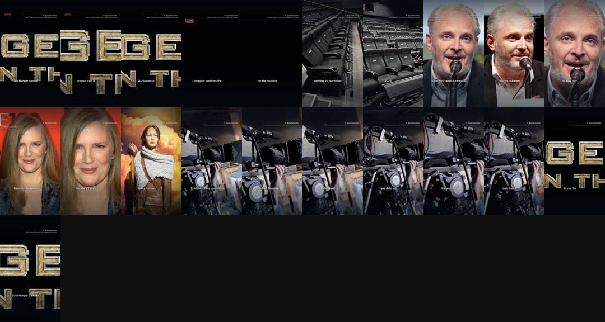
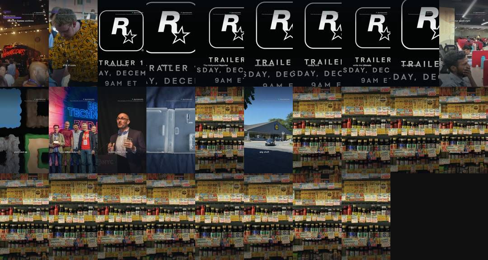
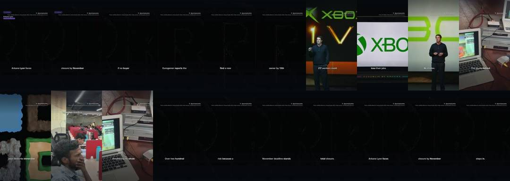
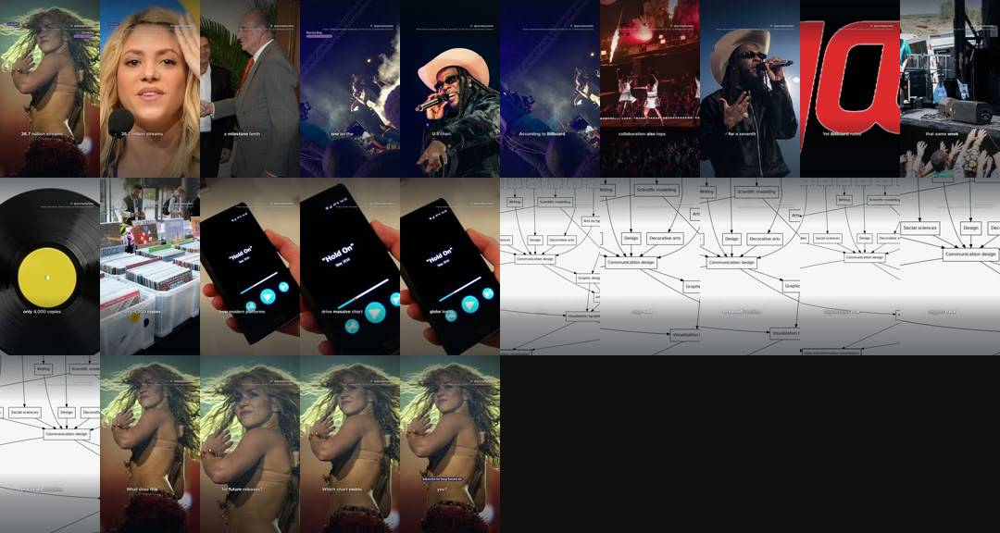
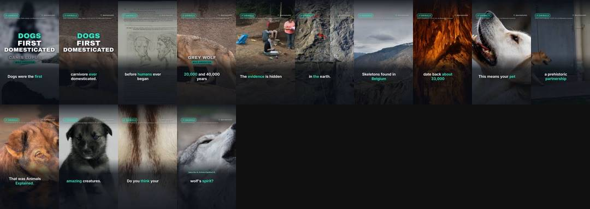
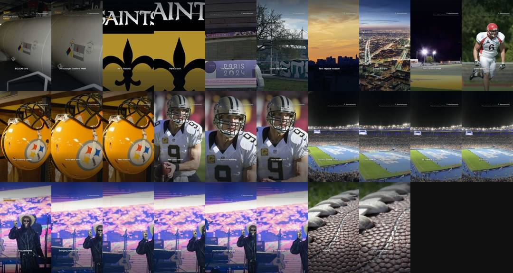
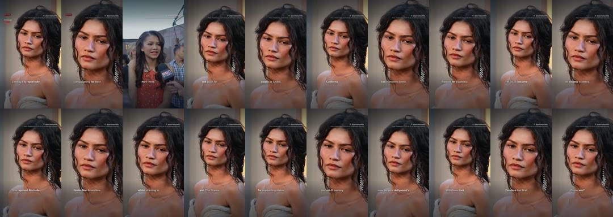
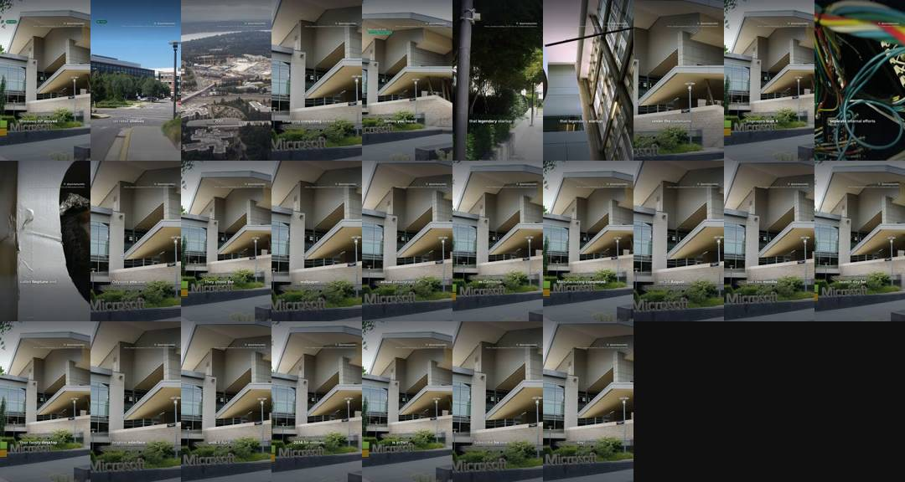

# Quickplay Daily review

**Progress** (Tue 27 Oct, 13:55): 17 of 1,000 subscribers · 11,203 of 10 million Shorts views in 90 days · 4,440 views in the last 24 hours (about 110,987 a day needed, 97 days left) · Instagram 1 and Facebook 0 followers.

YouTube checked Tue 27 Oct 13:43 (UK): 7 scheduled, 142 public, 22 uploads in the last 24 hours.

Instagram: connected as quickplaydaily · Facebook: connected to Quickplay Daily (checked Tue 27 Oct 11:12).

## Posts by day

YouTube counts Shorts by the day they go public. Instagram and Facebook build up to the same number over time.

| Day | YouTube | Instagram | Facebook | Target met? |
|---|---|---|---|---|
| Wed 28 Oct | 0 public, 3 scheduled | 0 | 0 | ⏳ 3 of 15 scheduled |
| Tue 27 Oct | 18 public, 6 scheduled | 4 | 1 | ✅ done |
| Mon 26 Oct | 12 public | 8 | 1 | ⚠️ 12 of 15 |
| Sun 25 Oct | 18 public | 4 | 1 | ✅ all out |
| Sat 24 Oct | 14 public | 26 | 3 | ⚠️ 14 of 15 |
| Fri 23 Oct | 19 public | 22 | 5 | ⚠️ 19 of 40 |
| Thu 22 Oct | 29 public | 18 | 16 | ⚠️ 29 of 40 |
| Wed 21 Oct | 29 public | 14 | 14 | ⚠️ 29 of 40 |

## Voice test

Each narrator is tried on real Shorts and judged on viewers not swiping away (1.00 x = typical for Shorts posted around the same time). GitHub gives the winners more Shorts by itself.

- michael (American male, friendly): 1.32 x typical, 29% stayed past the first seconds, 7 Shorts
- lab-voice-1019 (British male, 3.15 words a second): 1.20 x typical, 32% stayed past the first seconds, 5 Shorts
- daniel (British male, brisk): 1.16 x typical, 29% stayed past the first seconds, 3 Shorts
- george_dramatic (British male, more dramatic delivery): 1.03 x typical, 29% stayed past the first seconds, 9 Shorts
- george_quick (British male, clear and quicker): 0.87 x typical, 26% stayed past the first seconds, 4 Shorts
- lily (British female, bright): 0.82 x typical, 20% stayed past the first seconds, 5 Shorts
- lewis (British male, deeper and calm): 0.72 x typical, 22% stayed past the first seconds, 3 Shorts
- isabella (British female, warm): 1.44 x typical, 33% stayed past the first seconds, 2 Shorts
- heart (American female, expressive): 0.78 x typical, 25% stayed past the first seconds, 2 Shorts
- george_turbo (British male, the george voice on Chatterbox-Turbo (350M, one-step decoder, no exaggeration or cfg), same pace): 0 Shorts measured so far

## Look lab

New versions of the captions, voice pace, camera, colour and opening are tried on real Shorts. A version that beats the one it came from stays, and the next change builds on it.

- Testing captions: 68px weight 600 at 1290px, 4 words at a time, spoken word var(--accent), no panel (9 of 8 Shorts measured)
- Testing voice: British male, 3.15 words a second (5 of 8 Shorts measured)
- Testing energy: camera motion 0.9, punch-ins 0.03 (3 of 8 Shorts measured)
- Testing grade: contrast(1.0) saturate(1.06) sepia(0.0) brightness(1.0), vignette 0.0 (0 of 8 Shorts measured)
- Testing opening: the picture alone for 3 words, then the hook's card (0 of 8 Shorts measured)
- 2026-10-27: grade retired lab-grade-1023 (0.89x against 1.38x for natural over 14 Shorts)
- 2026-10-27: voice retired emma (0.84x against 1.32x for michael over 16 Shorts)
- 2026-10-26: opening kept lab-opening-1019: the picture alone for 1 word, then the hook's card (1.14x against 1.06x for graphic_first over 8 Shorts)
- 2026-10-25: grade retired cinematic (1.02x against 1.30x for natural over 29 Shorts)
- 2026-10-25: energy retired lab-energy-1019 (1.07x against 1.29x for steady over 15 Shorts)
- 2026-10-25: captions retired minimal (1.05x against 1.26x for lab-captions-1019 over 18 Shorts)

## Needs a look

Nothing here needs approving (approval is off): a failed Short is skipped and the next one takes its slot. Only Instagram or Facebook errors that keep coming back need fixing, in a Claude chat with the quickplay skill.

- **QD-086** What is the fastest land animal in the world? 🐆: failed. RuntimeError: checks failed: unclear narration in beats [2, 5]
- **QD-126** JADE hits US charts years after debut 🎶: failed. RuntimeError: checks failed: unclear narration in beats [0]
- **QD-217** Star Stories #1: Richard Hammond house tour: bats pause £2m 🦇: failed. RuntimeError: checks failed: unclear narration in beats [0]
- **QD-129** Clayface: The dark new body horror film in cinemas 🎬: facebook 2026-10-23 09:37 facebook publish: 400 {'error': {'message': 'We limit how often you can post, comment or do other things in a given amount of time in order to help protect the community from spam. You can try again later. Learn More', 'type': 'OAuthException', 'code': 368, 'err
- [raphinha birth date in Porto Alegre ⚽](https://youtube.com/shorts/ApvkxPKexGc): private and not scheduled

## Waiting for your approval

Reply to the daily message ("approve all", "approve all except QD-032", "reject QD-032"), or on GitHub: Actions, publish, Run workflow, and type the same.

### QD-144 · Tate McRae hits #1 in Australia 🎶
awaiting approval · 25 s · [watch preview](https://github.com/quickplay-studio/quickplay-autopilot/releases/tag/untagged-135ae7dbeab2e30bcf25)
- dry run: always waits for approval, never uploaded

### TEST-L1024 · Free Steam games to grab before time runs out 🎮
awaiting approval · 27 s · [watch preview](https://github.com/quickplay-studio/quickplay-autopilot/releases/tag/untagged-963c381ac97f3f823bcc)
- dry run: always waits for approval, never uploaded

## In the queue

- **QD-219** Film Explained #1: How Lord of the Rings Made Hobbits Small (rendering next)
- **QD-220** Level Up #2: Top 5 best-selling games ever 🎮 (rendering next)
- **QD-221** Did You Know #3: Eric Bauza: the voice legend we just lost 🎙️ (rendering next)
- **QD-222** Did You Know #4: Walter Koenig: the Star Trek legend's final honour (rendering next)
- **QD-223** Screen Time #4: Harry Potter: the character finally being cast (rendering next)
- **QD-224** Match Day #2: Mitchell Lawrie faces Luke Littler on Netflix 🎯 (rendering next)

## On the channel (latest first)

### Wed 28 Oct 12:30 · Space Facts #1: The Signal on Planet 9 | a short story 🚀
scheduled · 32 s · music: false-vacuum-decay · [script](../boards/done/QD-216.json) · [YouTube](https://youtube.com/shorts/QKykXue3OuY)

### Wed 28 Oct 7:00 · Film Facts #2: kpop demon hunters song: the soundtrack history
scheduled · 37 s · music: purple-desire · [script](../boards/done/QD-215.json) · [YouTube](https://youtube.com/shorts/hQWwgZnuEk4)

### Wed 28 Oct 6:00 · Music Explained #2: Who was Johann Sebastian Bach?
scheduled · 41 s · music: impossible-sacrifice · [script](../boards/done/QD-210.json) · [YouTube](https://youtube.com/shorts/VZenbNfVEnY)

### Tue 27 Oct 22:00 · iPhone Duo screen problems: the replacement deal
scheduled · 29 s · music: glitcher · [script](../boards/done/QD-214.json) · [YouTube](https://youtube.com/shorts/GNv-lzw9EXk)

### Tue 27 Oct 17:00 · GTA 6 hits consoles on 19 November 🎮
scheduled · 37 s · music: gta-type-beat · [script](../boards/done/QD-209.json) · [YouTube](https://youtube.com/shorts/GMcm2UzwGN0)

### Tue 27 Oct 16:00 · Megan Thee Stallion's Thin Ice: the 1999 twist 🔥
scheduled · 24 s · music: comin-wit-it · [script](../boards/done/QD-212.json) · [YouTube](https://youtube.com/shorts/uoxdTT_DOYM)

### Tue 27 Oct 14:00 · Game Facts #4: halloween 2026 game: the price drop you missed
private · 40 s · music: house-on-the-hill · [script](../boards/done/QD-207.json) · [YouTube](https://youtube.com/shorts/Ryp4jApiRtU)

### Tue 27 Oct 13:30 · Game Facts #5: GTA 6: 17% spike in time off requests
public · 29 s · music: death-duel · [script](../boards/done/QD-211.json) · [YouTube](https://youtube.com/shorts/kaI4B_oT77A)

### Tue 27 Oct 13:00 · GPT-6.1 Terra: OpenAI upgrades ChatGPT
public · 4 views · 21 s · music: pulsar · [script](../boards/done/QD-203.json) · [YouTube](https://youtube.com/shorts/rzEH4i2ko6Y)

### Tue 27 Oct 12:30 · gta 6: arrives on 19 November (Part 1) 🎮
public · 1 views · 28 s · music: once-upon-a-time · [script](../boards/done/QD-208.json) · [YouTube](https://youtube.com/shorts/YUI_nWZsC-Y)

### Tue 27 Oct 12:00 · GTA 6 launch trailer: 24 days to go 🎮
public · 29 views · 39 s · music: across-seas-and-lands · [script](../boards/done/QD-200.json) · [YouTube](https://youtube.com/shorts/04SNsgEZX5M)

### Tue 27 Oct 11:00 · Song Secrets #3: Beyonce solo debut hits number one in Billboard
public · 136 views · 32 s · music: dance-with-you · [script](../boards/done/QD-202.json) · [YouTube](https://youtube.com/shorts/OYNQGnJzq3s)

### Tue 27 Oct 10:00 · Film Facts #1: Wildwood runtime sets a stop-motion record 🎬
public · 3 views · 27 s · music: in-battery · [script](../boards/done/QD-201.json) · [YouTube](https://youtube.com/shorts/uDAbDV2tGw4)

### Tue 27 Oct 9:00 · Science Explained #1: Moon: why days were 5 hours long
public · 153 views · 29 s · music: fire-in-the-sky · [script](../boards/done/QD-190.json) · [YouTube](https://youtube.com/shorts/Kl7Qb1Wbtuw)

### Tue 27 Oct 8:00 · Kylian Mbappé: the 87th minute moment that changed everything ⚽
public · 36 views · 38 s · music: risen · [script](../boards/done/QD-189.json) · [YouTube](https://youtube.com/shorts/pRQAsVMbuIA)

### Tue 27 Oct 7:00 · Game Facts #2: Exoplanet Arcade Cabinet | a short story
public · 5 views · 40 s · music: defying-gravity · [script](../boards/done/QD-186.json) · [YouTube](https://youtube.com/shorts/Dd8fTVqyAz0)

### Tue 27 Oct 6:00 · Music Explained #1: Eurovision: the rule changing in 2027
public · 77 views · 30 s · music: f16 · [script](../boards/done/QD-183.json) · [YouTube](https://youtube.com/shorts/d5pHQxFOgaM)

### Tue 27 Oct 2:30 · Game Facts #3: GTA 6 is arriving on 19 November 2026
public · 8 views · 33 s · music: ten · on Instagram · on Facebook · [script](../boards/done/QD-195.json) · [YouTube](https://youtube.com/shorts/fuvSdaRMAb0)

### Tue 27 Oct 1:30 · Algol the Medusa star: why it winks 🌌
public · 8 views · 37 s · music: majestic-12 · on Instagram · [script](../boards/done/QD-188.json) · [YouTube](https://youtube.com/shorts/wEznV2CypzI)

### Mon 26 Oct 17:00 · Tech Explained #1: Why Your Phone Buzzes In Your Pocket
public · 7 views · 43 s · music: circuit-rush · [script](../boards/done/QD-187.json) · [YouTube](https://youtube.com/shorts/nG0i9IOA_wI)

### Mon 26 Oct 15:30 · Hunger Games: cast complete (Part 3)
public · 363 views · 31 s · music: stake-out · on Instagram · [script](../boards/done/QD-180.json) · [YouTube](https://youtube.com/shorts/VblVWSJqX6E)

### Mon 26 Oct 14:00 · Ralph Fiennes joins Hunger Games cast (Part 2)
public · 123 views · 30 s · music: stake-out · [script](../boards/done/QD-179.json) · [YouTube](https://youtube.com/shorts/o9QuOBxSUIo)

### Mon 26 Oct 13:00 · GTA 6: why the eighty dollar digital launch matters 🎮
public · 1 views · 40 s · music: sixseven · on Instagram · [script](../boards/done/QD-185.json) · [YouTube](https://youtube.com/shorts/NDbDMJxPXQk)

### Mon 26 Oct 12:30 · The Hunger Games: 2026 release date (Part 1)
public · 58 views · 32 s · music: stake-out · [script](../boards/done/QD-178.json) · [YouTube](https://youtube.com/shorts/AV8b-2E-z6s)

### Mon 26 Oct 12:00 · Arkane Lyon faces closure by November 🚨
public · 13 views · 29 s · music: twin-lynches · on Instagram · [script](../boards/done/QD-184.json) · [YouTube](https://youtube.com/shorts/HnPSGTsa258)

### Mon 26 Oct 11:00 · Song Secrets #2: Song secrets: Shakira's chart record
public · 884 views · 37 s · music: paradigm · [script](../boards/done/QD-182.json) · [YouTube](https://youtube.com/shorts/OoPuz2CbMhM)

### Mon 26 Oct 9:30 · Halloween: The Game: the ban you didn't expect 🎃
public · 8 views · 37 s · music: paradigm · on Instagram · [script](../boards/done/QD-181.json) · [YouTube](https://youtube.com/shorts/ntA-j4u3hWY)

### Mon 26 Oct 6:30 · Animals Explained #1: How dogs became man's best friend 🐕
public · 81 views · 29 s · music: stake-out · on Instagram · [script](../boards/done/QD-177.json) · [YouTube](https://youtube.com/shorts/Wvba1xTu2BM)

### Sun 25 Oct 23:30 · BioWare: fans petition after EA closure 🎮
public · 20 views · 35 s · music: duty-calls · on Instagram · on Facebook · [script](../boards/done/QD-176.json) · [YouTube](https://youtube.com/shorts/gPtD8qBcINI)

### Sun 25 Oct 22:00 · saints vs steelers: the Paris milestone explained
public · 198 views · 38 s · music: duty-calls · on Instagram · [script](../boards/done/QD-175.json) · [YouTube](https://youtube.com/shorts/Z7f5Da-Nd8Y)

### Sun 25 Oct 20:30 · Halloween 2026: top skywatching moments
public · 2 views · 30 s · music: horizons · [script](../boards/done/QD-174.json) · [YouTube](https://youtube.com/shorts/GGUpuX9LM9I)

### Sun 25 Oct 19:00 · This Week in Trends: Queen, Barbara Palvin and Jenna Ortega
public · 4 views · [YouTube](https://youtube.com/shorts/ajlYdYeu-CY)

### Sun 25 Oct 19:00 · barbara palvin 13 years old: the church choice 💒
public · 17 views · 32 s · music: level · [script](../boards/done/QD-173.json) · [YouTube](https://youtube.com/shorts/LENtoDiGI8E)

### Sun 25 Oct 17:00 · Mortimer and Whitehouse: Ted's last trip 🐾
public · 148 views · 38 s · music: rise-of-the-machines · [script](../boards/done/QD-172.json) · [YouTube](https://youtube.com/shorts/8NBbhUrLjGU)

### Sun 25 Oct 15:30 · UFC 333: Two title fights one night in Abu Dhabi
public · 5 views · 39 s · music: rise-of-the-machines · on Instagram · [script](../boards/done/QD-171.json) · [YouTube](https://youtube.com/shorts/KisKqgSnwHs)

### Sun 25 Oct 14:00 · XP's iconic hillside becomes footwear fashion (Part 2) 👟
public · 8 views · 38 s · music: rubberband · [script](../boards/done/QD-170.json) · [YouTube](https://youtube.com/shorts/uwq3RbhcXZQ)

### Sun 25 Oct 13:00 · Zendaya: the major category change explained
public · 75 views · 30 s · music: ego-chall · [script](../boards/done/QD-167.json) · [YouTube](https://youtube.com/shorts/ieaRJvZrp1Y)

### Sun 25 Oct 12:30 · Harry Kane scores 73 goals before Ballon d'Or ⚽
public · 160 views · 28 s · music: rise-of-the-machines · on Instagram · [script](../boards/done/QD-168.json) · [YouTube](https://youtube.com/shorts/qiBnn27q6ns)

### Sun 25 Oct 12:00 · Song Secrets #1: Dai Dai Shakira: the global chart record 🏆
public · 1,003 views · 27 s · music: paradise · [script](../boards/done/QD-165.json) · [YouTube](https://youtube.com/shorts/edZ6QEq7tGM)

### Sun 25 Oct 11:00 · Tech Truths #1: Windows XP arrived in shops (Part 1) 💻
public · 271 views · 39 s · music: after-sunset · [script](../boards/done/QD-169.json) · [YouTube](https://youtube.com/shorts/ycIgW6dE9lc)

