# Quickplay Daily review

**Progress** (Fri 30 Oct, 11:46): 22 of 1,000 subscribers · 14,789 of 10 million Shorts views in 90 days · 5,766 views in the last 24 hours (about 110,947 a day needed, 94 days left) · Instagram 1 and Facebook 0 followers.

YouTube checked Fri 30 Oct 11:34 (UK): 6 scheduled, 144 public, 12 uploads in the last 24 hours.

Instagram: connected as quickplaydaily · Facebook: connected to Quickplay Daily (checked Fri 30 Oct 11:39).

## Posts by day

YouTube counts Shorts by the day they go public. Instagram and Facebook build up to the same number over time.

| Day | YouTube | Instagram | Facebook | Target met? |
|---|---|---|---|---|
| Sat 31 Oct | 0 public, 4 scheduled | 0 | 0 | ⏳ 4 of 15 scheduled |
| Fri 30 Oct | 6 public, 3 scheduled | 8 | 1 | ⏳ 6 of 15 so far, 3 more scheduled |
| Thu 29 Oct | 7 public | 0 | 0 | no target then |
| Wed 28 Oct | 28 public | 0 | 1 | ✅ all out |
| Tue 27 Oct | 27 public | 8 | 1 | ✅ all out |
| Mon 26 Oct | 12 public | 8 | 1 | ⚠️ 12 of 15 |
| Sun 25 Oct | 18 public | 4 | 1 | ✅ all out |
| Sat 24 Oct | 14 public | 26 | 3 | ⚠️ 14 of 15 |

## Voice test

Each narrator is tried on real Shorts and judged on viewers not swiping away (1.00 x = typical for Shorts posted around the same time). GitHub gives the winners more Shorts by itself.

- isabella (British female, warm): 1.38 x typical, 34% stayed past the first seconds, 4 Shorts
- lewis (British male, deeper and calm): 1.00 x typical, 23% stayed past the first seconds, 5 Shorts
- daniel (British male, brisk): 1.00 x typical, 28% stayed past the first seconds, 7 Shorts
- lily (British female, bright): 0.98 x typical, 23% stayed past the first seconds, 5 Shorts
- george_quick (British male, clear and quicker): 0.87 x typical, 26% stayed past the first seconds, 4 Shorts
- heart (American female, expressive): 0.80 x typical, 26% stayed past the first seconds, 2 Shorts
- george_turbo (British male, the george voice on Chatterbox-Turbo (350M, one-step decoder, no exaggeration or cfg), same pace): 0 Shorts measured so far
- lab-voice-1028 (British male, 3.15 words a second): 0 Shorts measured so far

## Look lab

New versions of the captions, voice pace, camera, colour and opening are tried on real Shorts. A version that beats the one it came from stays, and the next change builds on it.

- Testing captions: 68px weight 600 at 1290px, 3 words at a time, spoken word #FFFFFF, no panel (2 of 8 Shorts measured)
- Testing voice: British male, 3.15 words a second (0 of 8 Shorts measured)
- Testing energy: camera motion 0.7, punch-ins 0.03 (0 of 8 Shorts measured)
- Testing grade: contrast(1.0) saturate(1.06) sepia(0.0) brightness(1.0), vignette 0.0 (12 of 8 Shorts measured)
- Testing opening: the picture alone for 3 words, then the hook's card (0 of 8 Shorts measured)
- 2026-10-30: opening retired lab-opening-1026 (1.10x against 1.13x for image_first over 10 Shorts)
- 2026-10-30: energy retired lab-energy-1025 (0.99x against 1.17x for steady over 8 Shorts)
- 2026-10-30: voice retired michael (1.19x against 1.57x for daniel over 11 Shorts)
- 2026-10-28: voice retired george_dramatic (making room for a new test (1.03x over 9 Shorts))
- 2026-10-28: voice retired lab-voice-1019 (0.88x against 1.04x for george over 8 Shorts)
- 2026-10-28: captions retired lab-captions-1024 (0.90x against 1.20x for lab-captions-1019 over 9 Shorts)

## Needs a look

Nothing here needs approving (approval is off): a failed Short is skipped and the next one takes its slot. Only Instagram or Facebook errors that keep coming back need fixing, in a Claude chat with the quickplay skill.

- **QD-086** What is the fastest land animal in the world? 🐆: failed. RuntimeError: checks failed: unclear narration in beats [2, 5]
- **QD-126** JADE hits US charts years after debut 🎶: failed. RuntimeError: checks failed: unclear narration in beats [0]
- **QD-217** Star Stories #1: Richard Hammond house tour: bats pause £2m 🦇: failed. RuntimeError: checks failed: unclear narration in beats [0]
- **QD-281** : failed (board rejected). meta.title: 1 to 70 characters
- **QD-129** Clayface: The dark new body horror film in cinemas 🎬: facebook 2026-10-23 09:37 facebook publish: 400 {'error': {'message': 'We limit how often you can post, comment or do other things in a given amount of time in order to help protect the community from spam. You can try again later. Learn More', 'type': 'OAuthException', 'code': 368, 'err
- **QD-189** Kylian Mbappé: the 87th minute moment that changed everything ⚽: instagram 2026-10-28 15:52 instagram processing: {'status_code': 'ERROR', 'status': 'ERROR', 'id': '17936872164167410'}
- **QD-207** Game Facts #4: halloween 2026 game: the price drop you missed: instagram 2026-10-28 09:48 instagram processing: {'status_code': 'ERROR', 'status': 'ERROR', 'id': '17936768628167410'}
- **QD-209** GTA 6 launch makes Emberville delay to 2027 🎮: instagram 2026-10-28 20:42 instagram processing: {'status_code': 'ERROR', 'status': 'ERROR', 'id': '17936944932167410'}
- **QD-228** Star Stories #2: Matthew Perry Netflix documentary 📺: instagram 2026-10-28 09:49 instagram processing: {'status_code': 'ERROR', 'status': 'ERROR', 'id': '17936768706167410'}

## Waiting for your approval

Reply to the daily message ("approve all", "approve all except QD-032", "reject QD-032"), or on GitHub: Actions, publish, Run workflow, and type the same.

### QD-144 · Tate McRae hits #1 in Australia 🎶
awaiting approval · 25 s · [watch preview](https://github.com/quickplay-studio/quickplay-autopilot/releases/tag/untagged-135ae7dbeab2e30bcf25)
- dry run: always waits for approval, never uploaded

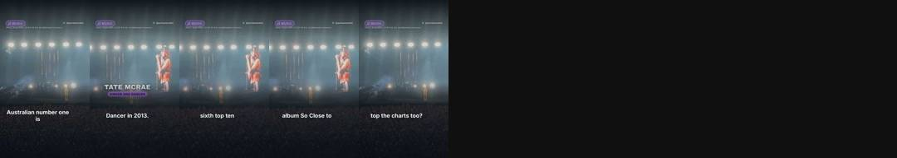

### QD-233 · Beyonce's 2003 album sold 317k in week one 🎤
awaiting approval · 31 s · [watch preview](https://github.com/quickplay-studio/quickplay-autopilot/releases/tag/untagged-39e898c890f9b5e0d19b)
- dry run: always waits for approval, never uploaded

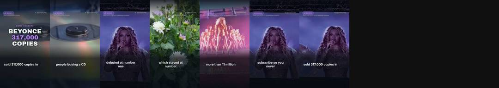

### QD-235 · Screen Time #5: Godzilla Minus One: the Oscar detail you missed
awaiting approval · 29 s · [watch preview](https://github.com/quickplay-studio/quickplay-autopilot/releases/tag/untagged-170659f512152c5cec1c)
- dry run: always waits for approval, never uploaded

### QD-236 · Big Science #2: James Webb Space Telescope 🔭
awaiting approval · 37 s · [watch preview](https://github.com/quickplay-studio/quickplay-autopilot/releases/tag/untagged-781c10b33a6b853aae08)
- dry run: always waits for approval, never uploaded

### QD-237 · Science Explained #3: How does gravity work? 🌌
awaiting approval · 37 s · [watch preview](https://github.com/quickplay-studio/quickplay-autopilot/releases/tag/untagged-70c9eb3dc6b5ca390831)
- dry run: always waits for approval, never uploaded

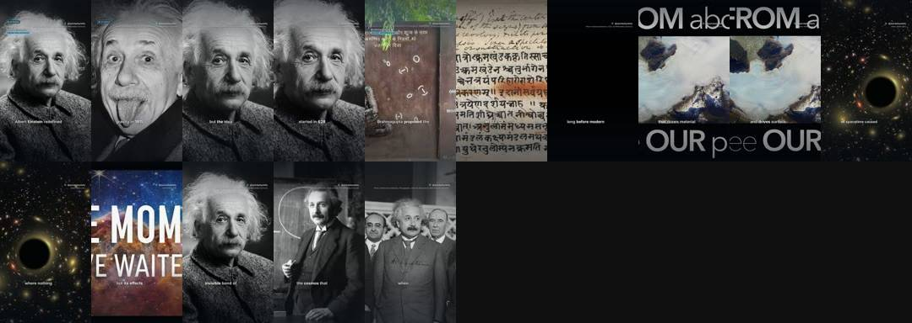

### QD-238 · Harry Kane's Ballon d'Or: the historic detail
awaiting approval · 37 s · [watch preview](https://github.com/quickplay-studio/quickplay-autopilot/releases/tag/untagged-be1abdd6a83fed70977e)
- dry run: always waits for approval, never uploaded

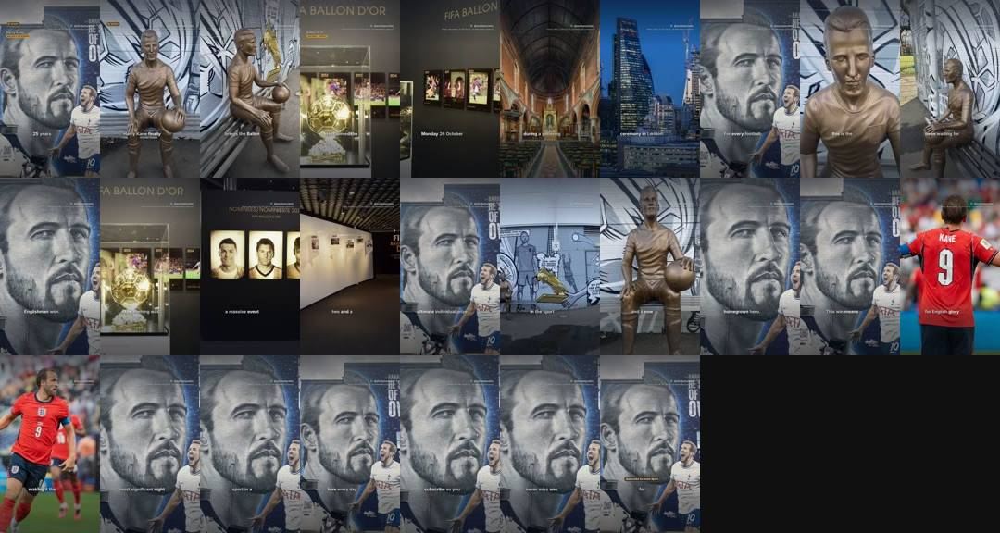

### QD-239 · Level Up #3: Minecraft: Why the logo and textures changed
awaiting approval · 36 s · [watch preview](https://github.com/quickplay-studio/quickplay-autopilot/releases/tag/untagged-9744bd94a18c7de4f045)
- dry run: always waits for approval, never uploaded

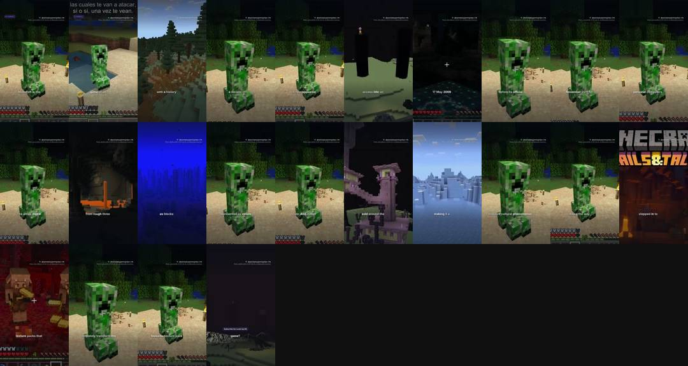

### QD-242 · Player One #1: Tetris: the Moscow secret behind 520 million
awaiting approval · 30 s · [watch preview](https://github.com/quickplay-studio/quickplay-autopilot/releases/tag/untagged-51e279b6b60fa0641f33)
- dry run: always waits for approval, never uploaded

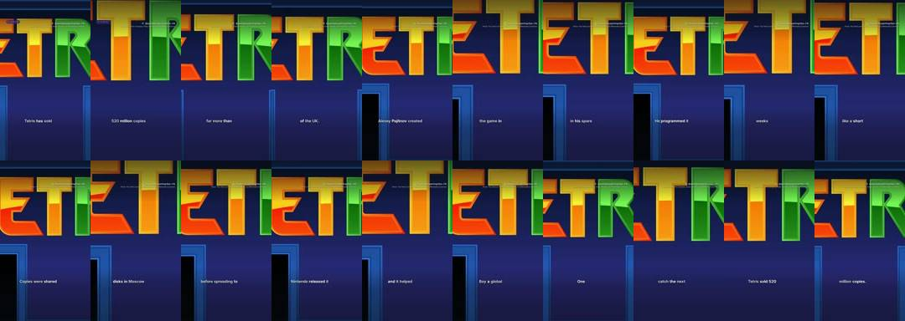

### QD-243 · On the Road #1: Bugatti Chiron: Why 10 Radiators?
awaiting approval · 40 s · [watch preview](https://github.com/quickplay-studio/quickplay-autopilot/releases/tag/untagged-ceeb119aa0a6231c1087)
- dry run: always waits for approval, never uploaded

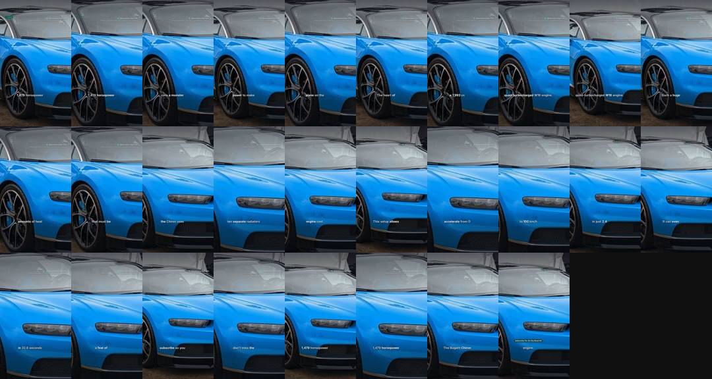

### QD-244 · Time Machine #1: Apollo 13: the pencil detail they held back 🚀
awaiting approval · 29 s · [watch preview](https://github.com/quickplay-studio/quickplay-autopilot/releases/tag/untagged-0b1dde92a13db838c964)
- dry run: always waits for approval, never uploaded

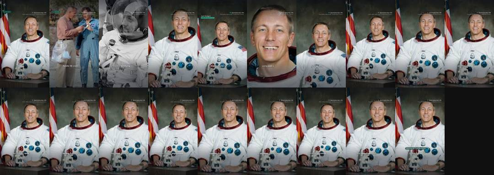

### QD-270 · Star Stories #6: Walter Koenig Chekov casting: the look that won it
awaiting approval · 28 s · [watch preview](https://github.com/quickplay-studio/quickplay-autopilot/releases/tag/untagged-22efe870abb33e11a7bd)
- dry run: always waits for approval, never uploaded

### QD-271 · walter koenig: the career numbers you missed
awaiting approval · 28 s · [watch preview](https://github.com/quickplay-studio/quickplay-autopilot/releases/tag/untagged-ed799da8d03143ce15fc)
- dry run: always waits for approval, never uploaded

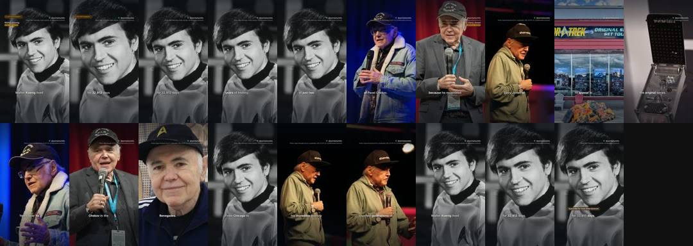

### TEST-L1024 · Free Steam games to grab before time runs out 🎮
awaiting approval · 27 s · [watch preview](https://github.com/quickplay-studio/quickplay-autopilot/releases/tag/untagged-963c381ac97f3f823bcc)
- dry run: always waits for approval, never uploaded

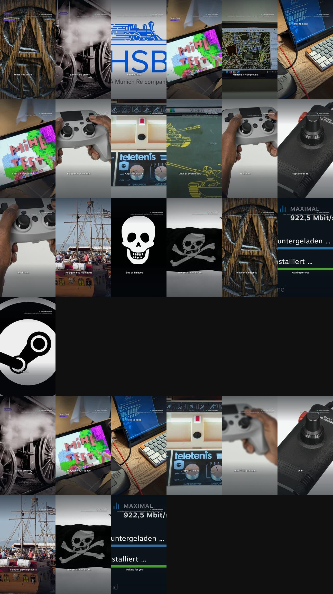

## On the channel (latest first)

### Sat 31 Oct 6:00 · Song Secrets #4: Michael Jackson's Thriller tops charts 37 weeks 🎵
scheduled · 36 s · music: dance-with-you · [script](../boards/done/QD-280.json) · [YouTube](https://youtube.com/shorts/el4EkoNqHOk)

### Sat 31 Oct 0:30 · William Contreras: 7th catcher World Series MVP 🏆
scheduled · 29 s · music: once-upon-a-time · [script](../boards/done/QD-282.json) · [YouTube](https://youtube.com/shorts/YnvZjFVmJuE)

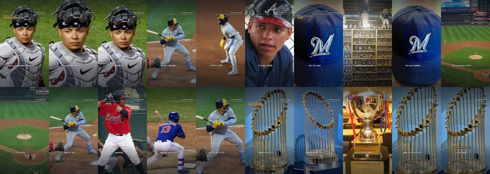

### Fri 30 Oct 15:30 · England vs PNG: the 68-point twist
scheduled · 37 s · music: once-upon-a-time · [script](../boards/done/QD-279.json) · [YouTube](https://youtube.com/shorts/TkoKydpcis4)

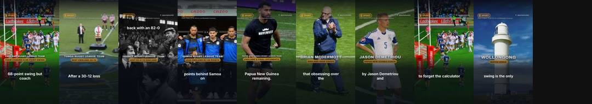

### Fri 30 Oct 14:00 · Ballon d'Or #4: Harry Kane Ballon d'Or: the 73 goal detail
scheduled · 40 s · music: once-upon-a-time · [script](../boards/done/QD-278.json) · [YouTube](https://youtube.com/shorts/3u12UL9te3w)

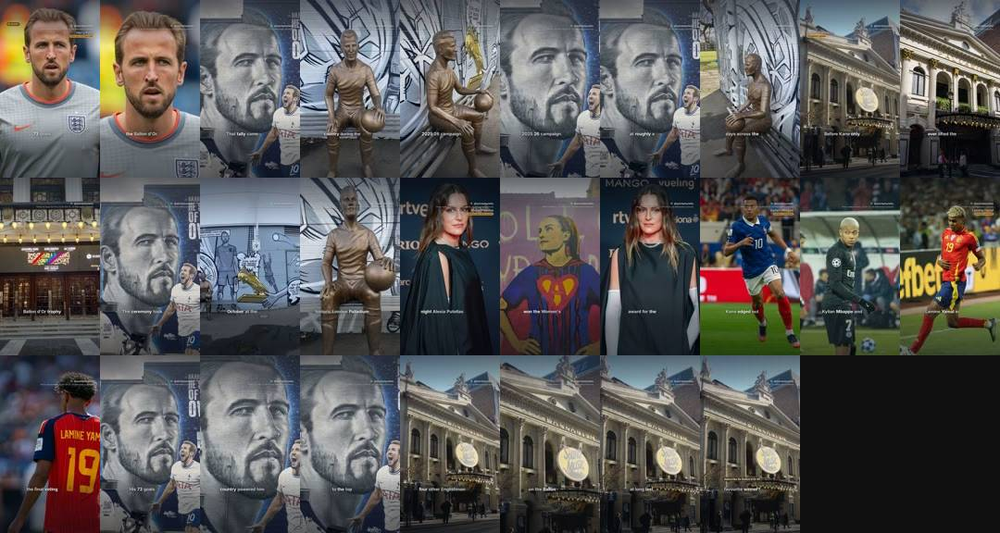

### Fri 30 Oct 13:00 · Celebrity Traitors #2: Final: series two ends today 🏁
scheduled · 26 s · music: stake-out · [script](../boards/done/QD-277.json) · [YouTube](https://youtube.com/shorts/qSpSNwWEBDQ)

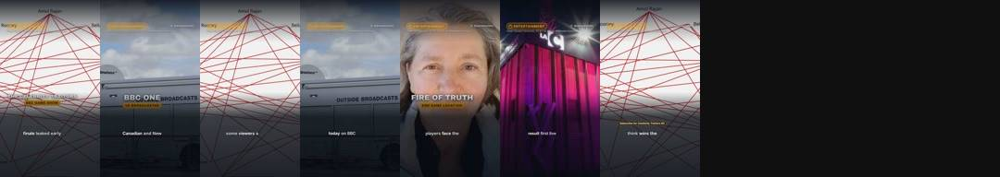

### Fri 30 Oct 12:00 · Game Explained #1: Switch cartridge taste: the real reason 👅
private · 37 s · music: hopping-trains · [script](../boards/done/QD-276.json) · [YouTube](https://youtube.com/shorts/CoVkFUukloo)

### Fri 30 Oct 11:00 · Harry Kane wins the Ballon d'Or after 25 years
public · 14 views · 37 s · music: in-battery · [script](../boards/done/QD-275.json) · [YouTube](https://youtube.com/shorts/vKutbd0tO_s)

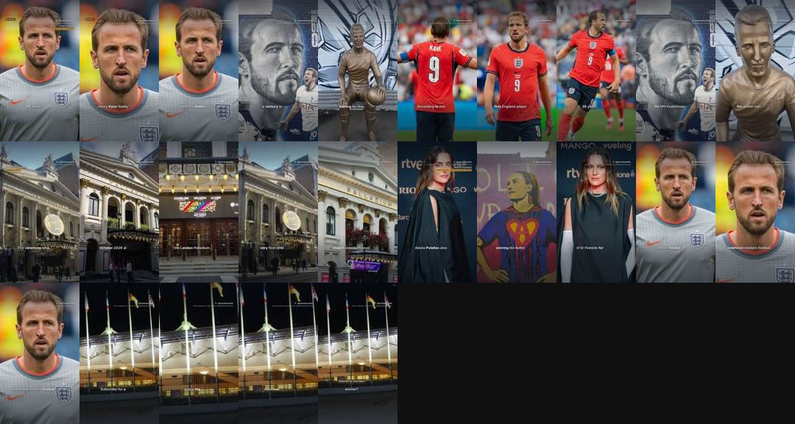

### Fri 30 Oct 9:30 · Dune: Part Three #2: Timothée Chalamet: Dune 3 trailer arrives
public · 1 views · 39 s · music: in-battery · [script](../boards/done/QD-274.json) · [YouTube](https://youtube.com/shorts/ybpJ2NLXQXg)

### Fri 30 Oct 8:00 · Sport Shocks #4: Ballon d'Or 2026 rankings: Harry Kane's first win 🏆
public · 71 views · 27 s · music: fire-in-the-sky · [script](../boards/done/QD-273.json) · [YouTube](https://youtube.com/shorts/EYdrZlrjsDk)

### Fri 30 Oct 6:30 · Sport Shocks #2: ballon d'or 2026 reaction: the detail you missed
public · 85 views · 36 s · music: fire-in-the-sky · [script](../boards/done/QD-246.json) · [YouTube](https://youtube.com/shorts/rsTvuhXP5xw)

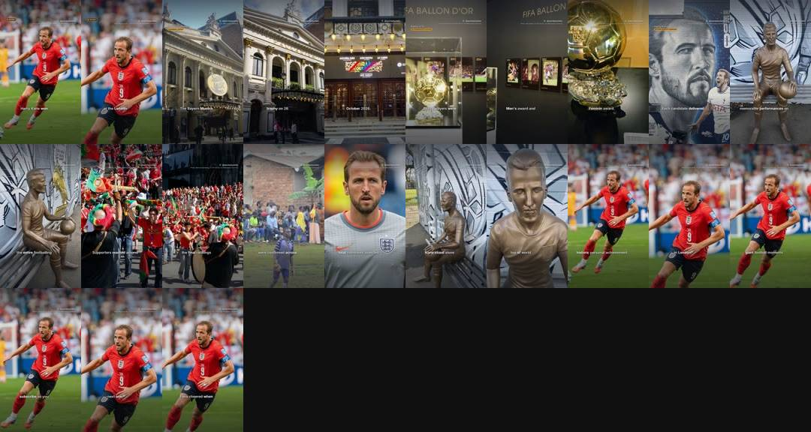

### Fri 30 Oct 3:30 · Harry Kane Ballon d'Or: first win in London 🏆
public · 347 views · 25 s · music: fire-in-the-sky · [script](../boards/done/QD-272.json) · [YouTube](https://youtube.com/shorts/U_eHPDhew8M)

### Thu 29 Oct 18:30 · Sport Explained #1: Ballon d'Or records: Messi vs Ronaldo
public · 915 views · 28 s · music: across-seas-and-lands · on Instagram · on Facebook · [script](../boards/done/QD-266.json) · [YouTube](https://youtube.com/shorts/sCd5ulaxtyM)

### Thu 29 Oct 8:00 · ballon d'or 2026 explained: the historic numbers
public · 176 views · 30 s · music: risen · on Instagram · [script](../boards/done/QD-262.json) · [YouTube](https://youtube.com/shorts/5doZBlCyBTM)

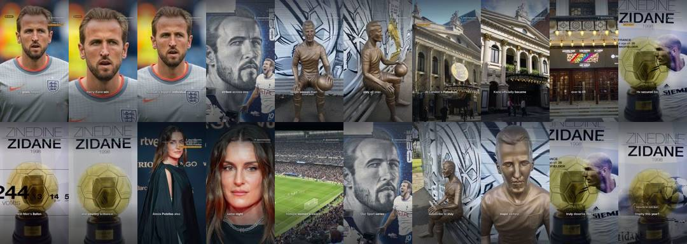

### Thu 29 Oct 6:30 · Star Stories #5: Walter Koenig: the record the Star Trek legend set
public · 131 views · 40 s · music: duty-calls · [script](../boards/done/QD-254.json) · [YouTube](https://youtube.com/shorts/nP6-GKOXTAQ)

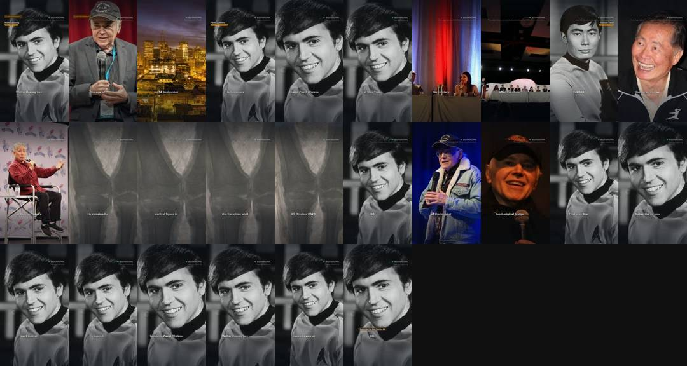

### Thu 29 Oct 3:30 · walter koenig: passed away aged 90 🖖
public · 822 views · 30 s · music: f16 · on Instagram · [script](../boards/done/QD-264.json) · [YouTube](https://youtube.com/shorts/hms_0daQGUk)

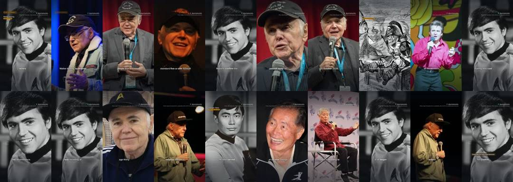

### Thu 29 Oct 2:00 · Walter Koenig: the co-star bond you never knew
public · 145 views · 35 s · music: cued-for-liftoff · on Instagram · [script](../boards/done/QD-263.json) · [YouTube](https://youtube.com/shorts/9VH6SdkGHkc)

### Thu 29 Oct 0:30 · Star Stories #7: Walter Koenig: the audition secret you never knew
public · 1,432 views · 38 s · music: duty-calls · [script](../boards/done/QD-255.json) · [YouTube](https://youtube.com/shorts/RAG2c_Lbf5k)

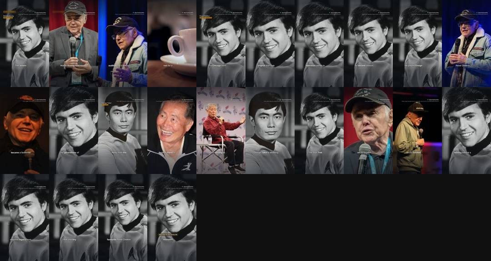

### Wed 28 Oct 23:15 · Walter Koenig: why he won the Chekov role 🖖
public · 47 views · 32 s · music: impossible-sacrifice · on Instagram · [script](../boards/done/QD-253.json) · [YouTube](https://youtube.com/shorts/GaOPYVvhV0A)

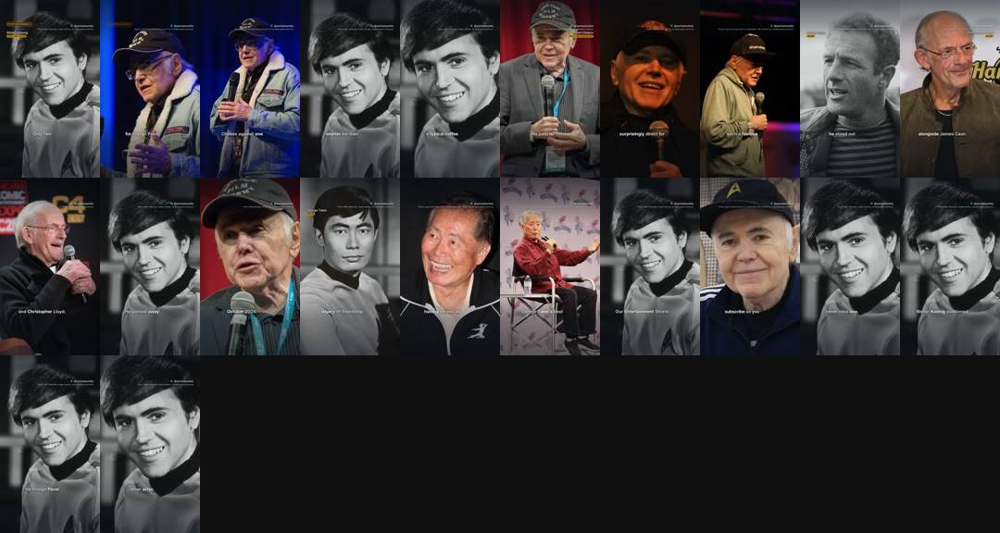

### Wed 28 Oct 22:00 · Walter Koenig: George Takei's moving final message 🖖
public · 66 views · 43 s · music: level · on Instagram · [script](../boards/done/QD-252.json) · [YouTube](https://youtube.com/shorts/7Y3RXzLhrvQ)

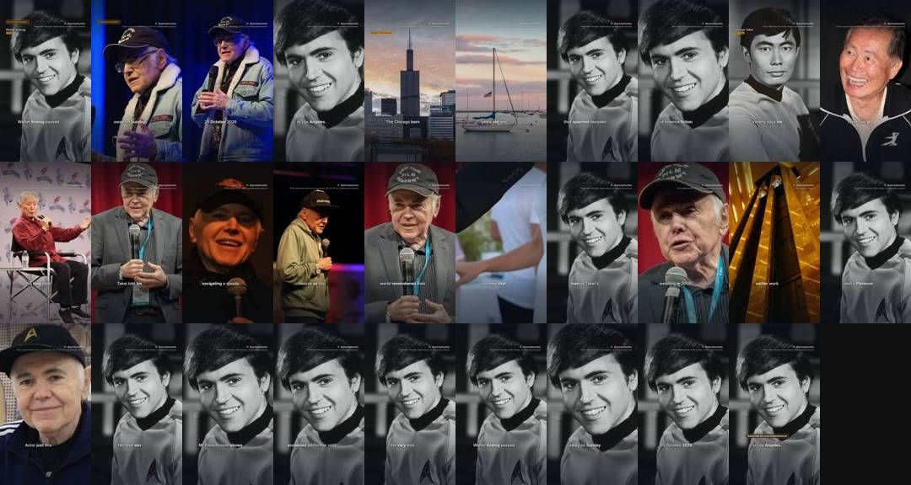

### Wed 28 Oct 20:30 · Star Stories #3: Walter Koenig: Star Trek actor dies aged 90
public · 33 views · 34 s · music: impossible-sacrifice · [script](../boards/done/QD-251.json) · [YouTube](https://youtube.com/shorts/FtaSBIjPChM)

### Wed 28 Oct 19:30 · Ballon d'Or: Harry Kane's historic win
public · 107 views · 29 s · music: duty-calls · [script](../boards/done/QD-250.json) · [YouTube](https://youtube.com/shorts/tlVEDrEN0jI)

### Wed 28 Oct 19:00 · Harry Kane Ballon d'Or, Dai Dai Record, Northumbria Mysteries
public · 4 views · [YouTube](https://youtube.com/shorts/Tul1oIPN8-Q)

### Wed 28 Oct 18:30 · Ballon d'Or #2: Harry Kane wins the 2026 Ballon d'Or 🏆
public · 2 views · 45 s · music: duty-calls · on Instagram · [script](../boards/done/QD-249.json) · [YouTube](https://youtube.com/shorts/PUuRZ0O2_n4)

### Wed 28 Oct 17:00 · Lord of the Rings filming: the massive timescale
public · 4 views · 44 s · music: once-upon-a-time · [script](../boards/done/QD-247.json) · [YouTube](https://youtube.com/shorts/u2uM8uaZDVo)

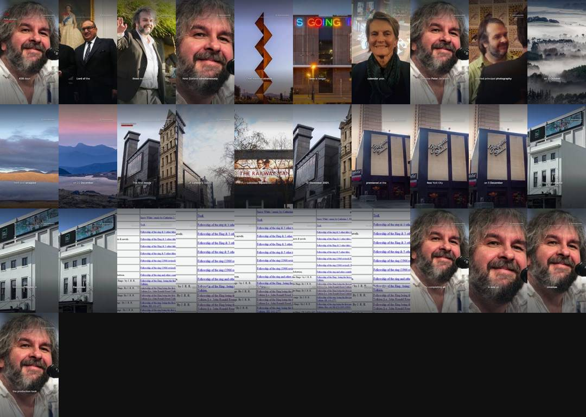

### Wed 28 Oct 16:00 · Game Facts #6: gta 6 install size officially revealed at 210 GB
public · 42 views · 36 s · music: ego-chall · on Instagram · [script](../boards/done/QD-227.json) · [YouTube](https://youtube.com/shorts/MOHuQDZpHZg)

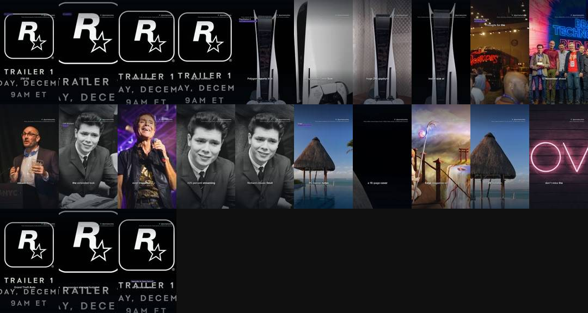

### Wed 28 Oct 15:30 · Film Explained #2: Star Wars Episode 4: why the saga starts there 🚀
public · 94 views · 39 s · music: duty-calls · [script](../boards/done/QD-248.json) · [YouTube](https://youtube.com/shorts/cgI2Hw6ect0)

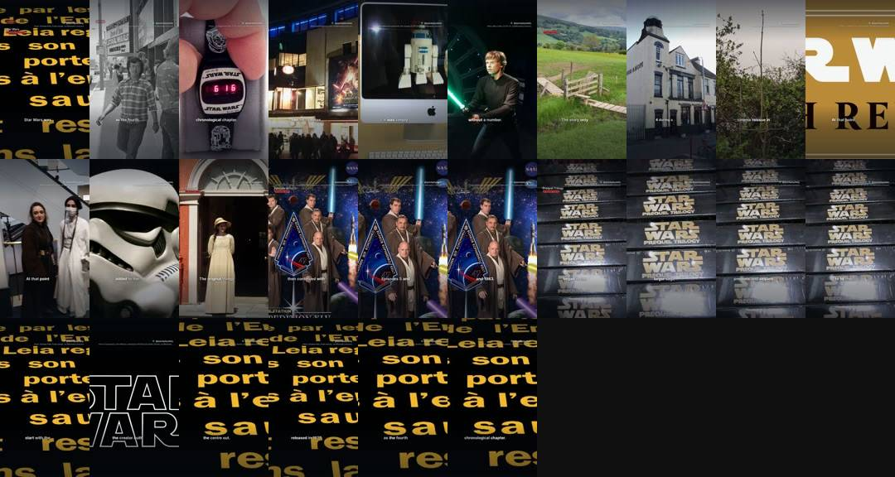

### Wed 28 Oct 13:30 · Science Explained #2: How gravity works: science explained 🌌
public · 42 views · 42 s · music: event-horizon · [script](../boards/done/QD-225.json) · [YouTube](https://youtube.com/shorts/JX9L5J_0LFY)

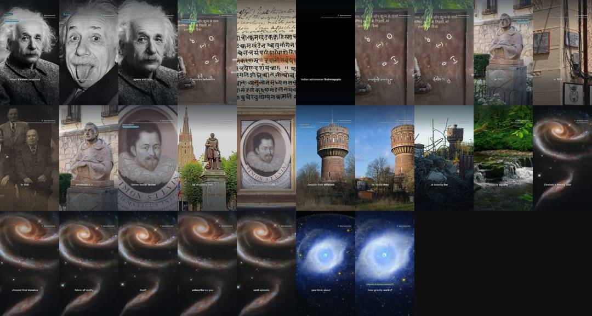

### Wed 28 Oct 12:30 · Space Facts #1: The Signal on Planet 9 | a short story 🚀
public · 19 views · 32 s · music: false-vacuum-decay · [script](../boards/done/QD-216.json) · [YouTube](https://youtube.com/shorts/QKykXue3OuY)

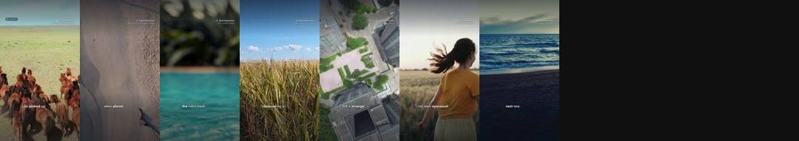

### Wed 28 Oct 10:00 · Harry Kane Ballon d'Or: chaotic London ceremony ⚽
public · 161 views · 31 s · music: once-upon-a-time · [script](../boards/done/QD-245.json) · [YouTube](https://youtube.com/shorts/rjO3XWFiBk0)

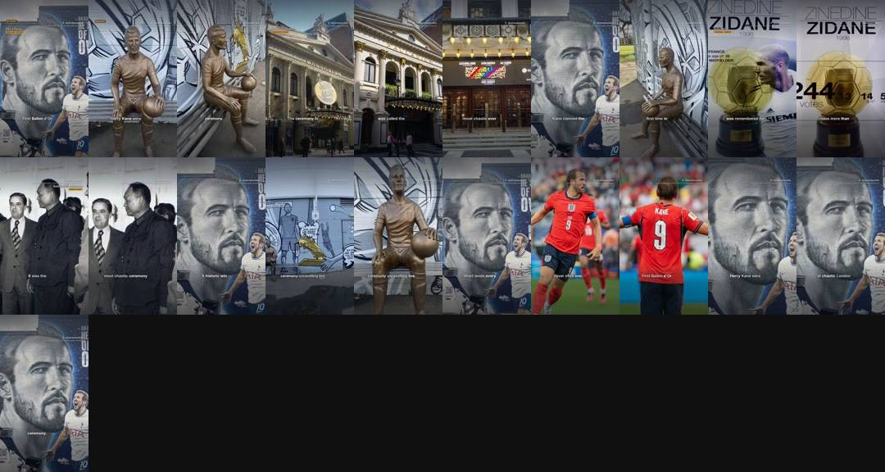

### Wed 28 Oct 8:00 · harry potter cast: Harry Gilby
public · 494 views · 25 s · music: across-seas-and-lands · [script](../boards/done/QD-226.json) · [YouTube](https://youtube.com/shorts/ac1e8cuVq7Y)

### Wed 28 Oct 7:00 · Film Facts #2: kpop demon hunters song: the soundtrack history
public · 1,041 views · 37 s · music: purple-desire · [script](../boards/done/QD-215.json) · [YouTube](https://youtube.com/shorts/hQWwgZnuEk4)

### Wed 28 Oct 6:00 · Music Explained #2: Who was Johann Sebastian Bach?
public · 19 views · 41 s · music: impossible-sacrifice · [script](../boards/done/QD-210.json) · [YouTube](https://youtube.com/shorts/VZenbNfVEnY)

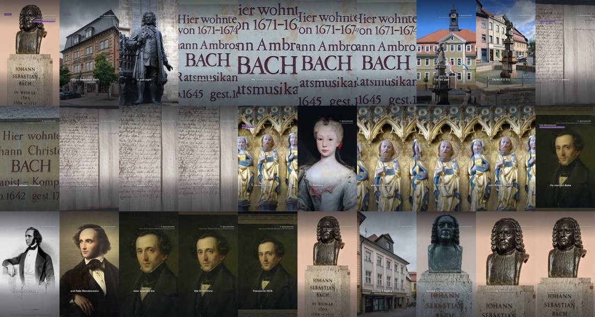

### Wed 28 Oct 2:30 · Star Stories #2: Matthew Perry Netflix documentary 📺
public · 157 views · 25 s · music: flight-is-aight · on Facebook · [script](../boards/done/QD-228.json) · [YouTube](https://youtube.com/shorts/OWR4ir1VnSg)

### Wed 28 Oct 1:30 · Film Explained #1: How Lord of the Rings Made Hobbits Small
public · 1,196 views · 37 s · music: duty-calls · [script](../boards/done/QD-219.json) · [YouTube](https://youtube.com/shorts/RyIxr9lB7BM)

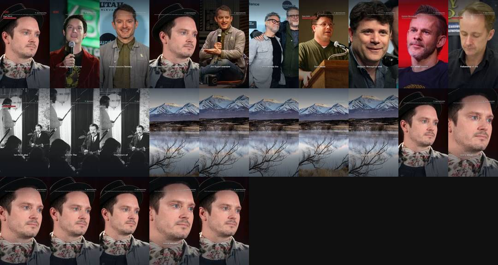

### Tue 27 Oct 22:00 · Apple iPhone Duo: who gets a replacement
public · 10 views · 29 s · music: glitcher · [script](../boards/done/QD-214.json) · [YouTube](https://youtube.com/shorts/GNv-lzw9EXk)

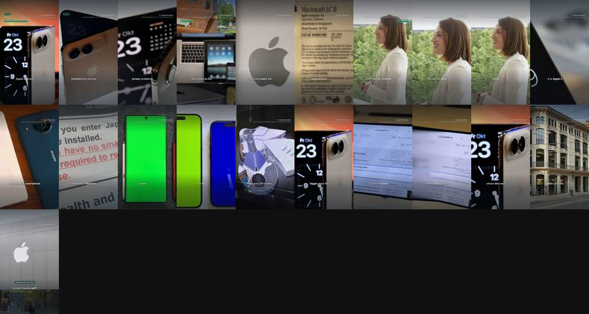

### Tue 27 Oct 17:00 · GTA 6 launch makes Emberville delay to 2027 🎮
public · 7 views · 37 s · music: gta-type-beat · [script](../boards/done/QD-209.json) · [YouTube](https://youtube.com/shorts/GMcm2UzwGN0)

### Tue 27 Oct 16:00 · Megan Thee Stallion's Thin Ice: the 1999 twist 🔥
public · 17 views · 24 s · music: comin-wit-it · [script](../boards/done/QD-212.json) · [YouTube](https://youtube.com/shorts/uoxdTT_DOYM)

### Tue 27 Oct 14:00 · Game Facts #4: halloween 2026 game: the price drop you missed
public · 28 views · 40 s · music: house-on-the-hill · [script](../boards/done/QD-207.json) · [YouTube](https://youtube.com/shorts/Ryp4jApiRtU)

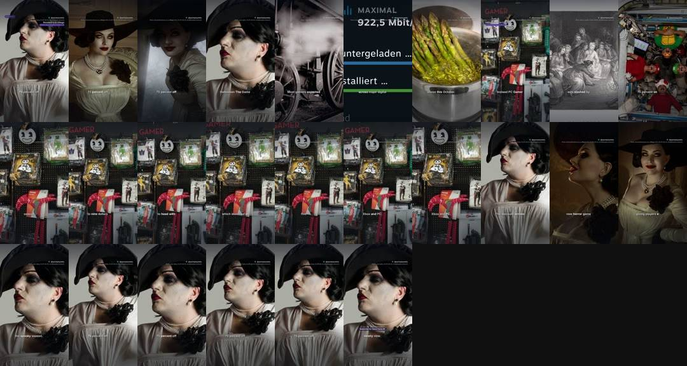

### Tue 27 Oct 13:30 · GTA 6 PC rumored 2027 as consoles drive leave spike
public · 41 views · 29 s · music: death-duel · [script](../boards/done/QD-211.json) · [YouTube](https://youtube.com/shorts/kaI4B_oT77A)

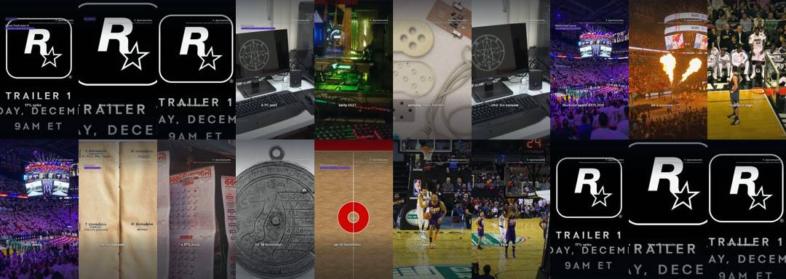

### Tue 27 Oct 13:00 · GPT-6.1 Terra: OpenAI upgrades ChatGPT
public · 75 views · 21 s · music: pulsar · [script](../boards/done/QD-203.json) · [YouTube](https://youtube.com/shorts/rzEH4i2ko6Y)

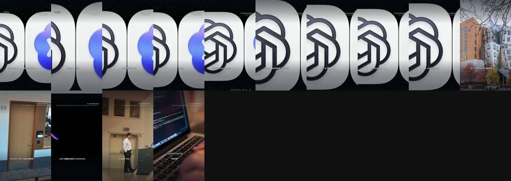
