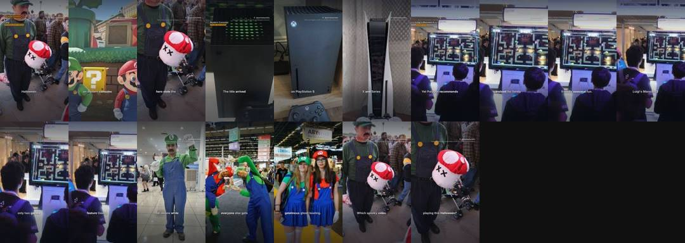

# Quickplay Daily review

**Progress** (Mon 26 Oct, 08:50): 16 of 1,000 subscribers · 9,936 of 10 million Shorts views in 90 days · 4,333 views in the last 24 hours (about 111,001 a day needed, 98 days left) · Instagram 1 and Facebook 0 followers.

YouTube checked Mon 26 Oct 7:38 (UK): 3 scheduled, 146 public, 17 uploads in the last 24 hours.

Instagram: connected as quickplaydaily · Facebook: connected to Quickplay Daily (checked Mon 26 Oct 8:20).

## Posts by day

YouTube counts Shorts by the day they go public. Instagram and Facebook build up to the same number over time.

| Day | YouTube | Instagram | Facebook | Target met? |
|---|---|---|---|---|
| Tue 27 Oct | 0 public | 0 | 0 | ⏳ 0 of 15 scheduled |
| Mon 26 Oct | 1 public, 5 scheduled | 4 | 1 | ⏳ 1 of 15 so far, 5 more scheduled |
| Sun 25 Oct | 18 public | 4 | 1 | ✅ all out |
| Sat 24 Oct | 14 public | 26 | 3 | ⚠️ 14 of 15 |
| Fri 23 Oct | 19 public | 22 | 5 | ⚠️ 19 of 40 |
| Thu 22 Oct | 29 public | 18 | 16 | ⚠️ 29 of 40 |
| Wed 21 Oct | 29 public | 14 | 14 | ⚠️ 29 of 40 |
| Tue 20 Oct | 7 public | 10 | 10 | ⚠️ 7 of 24 |

## Voice test

Each narrator is tried on real Shorts and judged on viewers not swiping away (1.00 x = typical for Shorts posted around the same time). GitHub gives the winners more Shorts by itself.

- lab-voice-1019 (British male, 3.15 words a second): 1.56 x typical, 39% stayed past the first seconds, 3 Shorts
- george_dramatic (British male, more dramatic delivery): 1.06 x typical, 29% stayed past the first seconds, 9 Shorts
- emma (British female): 0.98 x typical, 24% stayed past the first seconds, 9 Shorts
- george_quick (British male, clear and quicker): 0.95 x typical, 24% stayed past the first seconds, 4 Shorts
- michael (American male, friendly): 1.49 x typical, 37% stayed past the first seconds, 2 Shorts
- lily (British female, bright): 1.19 x typical, 30% stayed past the first seconds, 2 Shorts
- heart (American female, expressive): 1.06 x typical, 26% stayed past the first seconds, 2 Shorts
- lewis (British male, deeper and calm): 0.96 x typical, 24% stayed past the first seconds, 1 Short
- isabella (British female, warm): 0.90 x typical, 22% stayed past the first seconds, 1 Short
- george_turbo (British male, the george voice on Chatterbox-Turbo (350M, one-step decoder, no exaggeration or cfg), same pace): 0 Shorts measured so far
- daniel (British male, brisk): 0 Shorts measured so far

## Look lab

New versions of the captions, voice pace, camera, colour and opening are tried on real Shorts. A version that beats the one it came from stays, and the next change builds on it.

- Testing captions: 68px weight 600 at 1290px, 4 words at a time, spoken word var(--accent), no panel (3 of 8 Shorts measured)
- Testing voice: British male, 3.15 words a second (3 of 8 Shorts measured)
- Testing energy: camera motion 0.9, punch-ins 0.03 (0 of 8 Shorts measured)
- Testing grade: contrast(0.96) saturate(1.0) sepia(0.0) brightness(1.0), vignette 0.0 (2 of 8 Shorts measured)
- Testing opening: the picture alone for 3 words, then the hook's card (0 of 8 Shorts measured)
- 2026-10-26: opening kept lab-opening-1019: the picture alone for 1 word, then the hook's card (1.14x against 1.06x for graphic_first over 8 Shorts)
- 2026-10-25: grade retired cinematic (1.02x against 1.30x for natural over 29 Shorts)
- 2026-10-25: energy retired lab-energy-1019 (1.07x against 1.29x for steady over 15 Shorts)
- 2026-10-25: captions retired minimal (1.05x against 1.26x for lab-captions-1019 over 18 Shorts)
- 2026-10-24: captions kept lab-captions-1019: 68px weight 600 at 1290px, 4 words at a time, spoken word #FFFFFF, no panel (1.08x against 1.06x for clean over 25 Shorts)
- 2026-10-23: opening retired graphic_first (1.22x against 1.88x for image_first over 35 Shorts)

## Needs a look

Nothing here needs approving (approval is off): a failed Short is skipped and the next one takes its slot. Only Instagram or Facebook errors that keep coming back need fixing, in a Claude chat with the quickplay skill.

- **QD-086** What is the fastest land animal in the world? 🐆: failed. RuntimeError: checks failed: unclear narration in beats [2, 5]
- **QD-126** JADE hits US charts years after debut 🎶: failed. RuntimeError: checks failed: unclear narration in beats [0]
- **QD-129** Clayface: The dark new body horror film in cinemas 🎬: facebook 2026-10-23 09:37 facebook publish: 400 {'error': {'message': 'We limit how often you can post, comment or do other things in a given amount of time in order to help protect the community from spam. You can try again later. Learn More', 'type': 'OAuthException', 'code': 368, 'err
- [raphinha birth date in Porto Alegre ⚽](https://youtube.com/shorts/ApvkxPKexGc): private and not scheduled

## Waiting for your approval

Reply to the daily message ("approve all", "approve all except QD-032", "reject QD-032"), or on GitHub: Actions, publish, Run workflow, and type the same.

### QD-144 · Tate McRae hits #1 in Australia 🎶
awaiting approval · 25 s · [watch preview](https://github.com/quickplay-studio/quickplay-autopilot/releases/tag/untagged-135ae7dbeab2e30bcf25)
- dry run: always waits for approval, never uploaded

### TEST-L1024 · Free Steam games to grab before time runs out 🎮
awaiting approval · 27 s · [watch preview](https://github.com/quickplay-studio/quickplay-autopilot/releases/tag/untagged-963c381ac97f3f823bcc)
- dry run: always waits for approval, never uploaded

## On the channel (latest first)

### Mon 26 Oct 15:30 · Hunger Games: cast complete (Part 3)
scheduled · 31 s · music: stake-out · [script](../boards/done/QD-180.json) · [YouTube](https://youtube.com/shorts/VblVWSJqX6E)

### Mon 26 Oct 14:00 · Ralph Fiennes joins Hunger Games cast (Part 2)
scheduled · 30 s · music: stake-out · [script](../boards/done/QD-179.json) · [YouTube](https://youtube.com/shorts/o9QuOBxSUIo)

### Mon 26 Oct 12:30 · The Hunger Games: 2026 release date (Part 1)
scheduled · 32 s · music: stake-out · [script](../boards/done/QD-178.json) · [YouTube](https://youtube.com/shorts/AV8b-2E-z6s)

### Mon 26 Oct 6:30 · Animals Explained #1: How dogs became man's best friend 🐕
public · 7 views · 29 s · music: stake-out · on Instagram · [script](../boards/done/QD-177.json) · [YouTube](https://youtube.com/shorts/Wvba1xTu2BM)

### Sun 25 Oct 23:30 · BioWare: fans petition after EA closure 🎮
public · 2 views · 35 s · music: duty-calls · on Facebook · [script](../boards/done/QD-176.json) · [YouTube](https://youtube.com/shorts/gPtD8qBcINI)

### Sun 25 Oct 22:00 · saints vs steelers: the Paris milestone explained
public · 90 views · 38 s · music: duty-calls · [script](../boards/done/QD-175.json) · [YouTube](https://youtube.com/shorts/Z7f5Da-Nd8Y)

### Sun 25 Oct 20:30 · Halloween skywatch: five spooky targets revealed
public · 2 views · 30 s · music: horizons · [script](../boards/done/QD-174.json) · [YouTube](https://youtube.com/shorts/GGUpuX9LM9I)

### Sun 25 Oct 19:00 · This Week in Trends: Queen, Barbara Palvin and Jenna Ortega
public · 4 views · [YouTube](https://youtube.com/shorts/ajlYdYeu-CY)

### Sun 25 Oct 19:00 · barbara palvin 13 years old: the church choice 💒
public · 9 views · 32 s · music: level · [script](../boards/done/QD-173.json) · [YouTube](https://youtube.com/shorts/LENtoDiGI8E)

### Sun 25 Oct 17:00 · Mortimer and Whitehouse: Ted's last trip 🐾
public · 49 views · 38 s · music: rise-of-the-machines · [script](../boards/done/QD-172.json) · [YouTube](https://youtube.com/shorts/8NBbhUrLjGU)

### Sun 25 Oct 15:30 · Sport Shocks #1: UFC 333: Volkanovski wins record ninth title
public · 5 views · 39 s · music: rise-of-the-machines · on Instagram · [script](../boards/done/QD-171.json) · [YouTube](https://youtube.com/shorts/KisKqgSnwHs)

### Sun 25 Oct 14:00 · Tech Truths #3: Windows XP Bliss wallpaper now on Crocs (Part 2) 👟
public · 5 views · 38 s · music: rubberband · [script](../boards/done/QD-170.json) · [YouTube](https://youtube.com/shorts/uwq3RbhcXZQ)

### Sun 25 Oct 13:00 · Zendaya: the major category change explained
public · 63 views · 30 s · music: ego-chall · [script](../boards/done/QD-167.json) · [YouTube](https://youtube.com/shorts/ieaRJvZrp1Y)

### Sun 25 Oct 12:30 · Harry Kane scores 73 goals before Ballon d'Or ⚽
public · 150 views · 28 s · music: rise-of-the-machines · on Instagram · [script](../boards/done/QD-168.json) · [YouTube](https://youtube.com/shorts/qiBnn27q6ns)

### Sun 25 Oct 12:00 · Song Secrets #1: Dai Dai Shakira: the global chart record 🏆
public · 973 views · 27 s · music: paradise · [script](../boards/done/QD-165.json) · [YouTube](https://youtube.com/shorts/edZ6QEq7tGM)

### Sun 25 Oct 11:00 · Tech Truths #1: Windows XP arrived in shops (Part 1) 💻
public · 202 views · 39 s · music: after-sunset · [script](../boards/done/QD-169.json) · [YouTube](https://youtube.com/shorts/ycIgW6dE9lc)

### Sun 25 Oct 9:00 · Halloween: The Game secret you might have missed
public · 46 views · 27 s · music: hopping-trains · [script](../boards/done/QD-166.json) · [YouTube](https://youtube.com/shorts/cyrwyp0Kldk)

### Sun 25 Oct 7:00 · Ballon d'Or 2026 ceremony is moving to London
public · 615 views · 38 s · music: the-bombs · on Instagram · [script](../boards/done/QD-162.json) · [YouTube](https://youtube.com/shorts/6YlbgON866U)

### Sun 25 Oct 5:00 · GTA 6 price: the physical edition surprise 🎮
public · 269 views · 27 s · music: the-bombs · on Instagram · [script](../boards/done/QD-164.json) · [YouTube](https://youtube.com/shorts/m4dcmkj0AhI)

### Sun 25 Oct 4:00 · Richard E Grant admits betrayal to Joe Lycett
public · 199 views · 25 s · music: the-bombs · [script](../boards/done/QD-163.json) · [YouTube](https://youtube.com/shorts/MpzJ9obgR3M)

### Sun 25 Oct 2:30 · Raye is 28 and Where Is My Husband just hit a billion streams 🎉
public · 372 views · 27 s · music: mirror-mirror · [script](../boards/done/QD-161.json) · [YouTube](https://youtube.com/shorts/Y3nAUT-nrQc)

### Sun 25 Oct 1:30 · Free Steam games you can play right now (Part 2) 🎮
public · 292 views · 27 s · music: try-to-catch-me · on Instagram · on Facebook · [script](../boards/done/QD-159.json) · [YouTube](https://youtube.com/shorts/UXaR-4xKM8Q)

### Sun 25 Oct 0:30 · Free Steam games to grab before time runs out (Part 1) 🎮
public · 114 views · 27 s · music: death-duel · on Instagram · [script](../boards/done/QD-158.json) · [YouTube](https://youtube.com/shorts/ver1S5QH3yo)

### Sat 24 Oct 16:30 · Kimi Antonelli: F1's youngest world champion? 🏎️
public · 33 views · 32 s · music: death-duel · [script](../boards/done/QD-157.json) · [YouTube](https://youtube.com/shorts/gIS6da6LTVE)

### Sat 24 Oct 15:30 · Kristen Wiig's Palm Royale is over after just two seasons 📺
public · 10 views · 26 s · music: purple-desire · [script](../boards/done/QD-156.json) · [YouTube](https://youtube.com/shorts/EcMJ6WpHiy0)

### Sat 24 Oct 14:00 · Country legend John Anderson has died aged 71 🎸
public · 26 views · 26 s · music: mississippi-mover · [script](../boards/done/QD-155.json) · [YouTube](https://youtube.com/shorts/yC_shy0URVM)

### Sat 24 Oct 13:00 · Volkanovski vs Evloev: UFC 333 record on the line 🥊
public · 79 views · 34 s · music: death-duel · [script](../boards/done/QD-154.json) · [YouTube](https://youtube.com/shorts/M-WnVtohhXI)

### Sat 24 Oct 12:00 · The Ballon d'Or is coming to London for the first time 🏆
public · 47 views · 37 s · music: once-upon-a-time · [script](../boards/done/QD-153.json) · [YouTube](https://youtube.com/shorts/hJZL-czewhY)

### Sat 24 Oct 11:00 · Melanie C leads a sweaty Strictly workout to her own track 💪
public · 178 views · 30 s · music: dance-with-you · [script](../boards/done/QD-152.json) · [YouTube](https://youtube.com/shorts/fGjeLLGyljU)

### Sat 24 Oct 10:00 · GTA 6 on 19 November: no multiplayer at launch? 🕹️
public · 19 views · 27 s · music: gta-type-beat · on Instagram · [script](../boards/done/QD-151.json) · [YouTube](https://youtube.com/shorts/jDOsuCfxHVw)

### Sat 24 Oct 9:00 · Street Fighter movie: Chun-Li's 12-egg diet 🥚
public · 409 views · 32 s · music: ten · [script](../boards/done/QD-056.json) · [YouTube](https://youtube.com/shorts/lc62rdRQvmk)

### Sat 24 Oct 8:00 · New Alien movie confirmed, and Ridley Scott is producing 👽
public · 57 views · 30 s · music: pulsar · [script](../boards/done/QD-148.json) · [YouTube](https://youtube.com/shorts/ZNbWfnNLFnU)

### Sat 24 Oct 7:00 · GTA 6 has no disc, so what will it cost you? 🎮
public · 18 views · 24 s · music: pulsar · [script](../boards/done/QD-146.json) · [YouTube](https://youtube.com/shorts/qQiayx_AZBQ)

### Sat 24 Oct 5:00 · How Barbara Palvin was discovered at age 13 ✨
public · 1,166 views · 28 s · music: f16 · [script](../boards/done/QD-076.json) · [YouTube](https://youtube.com/shorts/bENhL4PxDDE)

### Sat 24 Oct 4:00 · Jorja Smith sings at the Amy Winehouse tribute 🎤
public · 242 views · 29 s · music: mas-cafe · [script](../boards/done/QD-147.json) · [YouTube](https://youtube.com/shorts/OXaGNn5zGH8)

### Sat 24 Oct 2:30 · Cyberpunk 2077 now fits in your hands 🎮
public · 35 views · 22 s · music: pulsar · on Facebook · [script](../boards/done/QD-149.json) · [YouTube](https://youtube.com/shorts/zIJUGpN-otU)

### Sat 24 Oct 0:30 · BABYMONSTER's G-Dragon Drip collab 🎧
public · 78 views · 21 s · music: paradise · on Facebook · [script](../boards/done/QD-145.json) · [YouTube](https://youtube.com/shorts/IRlAawe_xY8)

### Fri 23 Oct 18:30 · From TV star to Forbes 30 Under 30 🌟
public · 3 views · 29 s · music: purple-desire · on Facebook · [script](../boards/done/QD-143.json) · [YouTube](https://youtube.com/shorts/FvEctqCZhx4)

### Fri 23 Oct 18:00 · Jerry Hall’s early school exit and TV comeback 🌟
public · 17 views · 29 s · music: after-sunset · on Facebook · [script](../boards/done/QD-142.json) · [YouTube](https://youtube.com/shorts/Qn-Zk4JvlxM)

### Fri 23 Oct 17:30 · Avengers Doomsday preview drops during World Series ⚾
public · 533 views · 24 s · music: in-battery · on Facebook · [script](../boards/done/QD-141.json) · [YouTube](https://youtube.com/shorts/ijQ5iXKFmhU)

